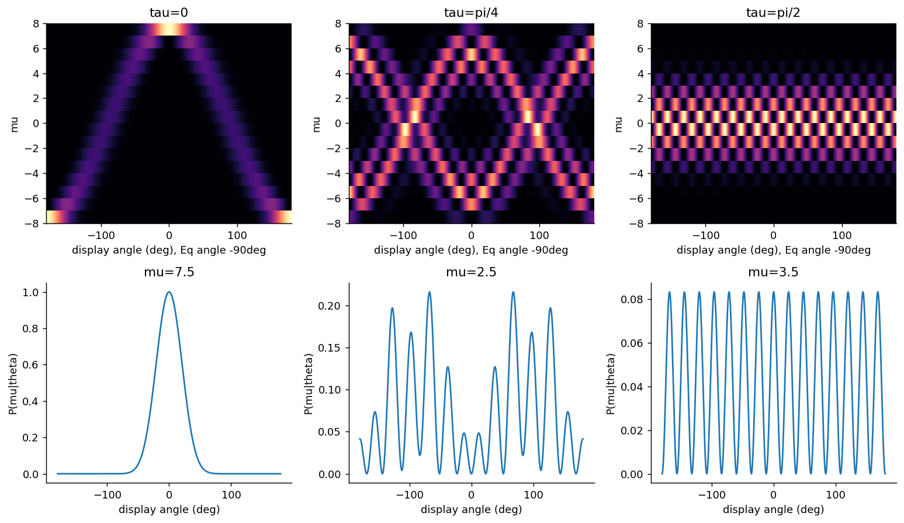
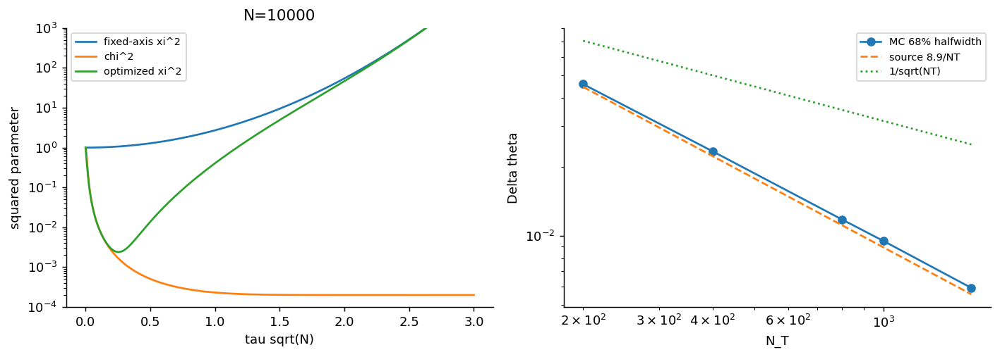
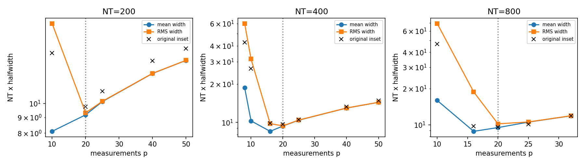

# 0711.4840: Entanglement, Nonlinear Dynamics, and the Heisenberg Limit

Preprint: [arXiv:0711.4840v3 — Entanglement, Nonlinear Dynamics, and the Heisenberg Limit](https://arxiv.org/abs/0711.4840v3)

Published as: [Entanglement, Nonlinear Dynamics, and the Heisenberg Limit](https://doi.org/10.1103/PhysRevLett.102.100401)

Formal citation: Phys. Rev. Lett. 102, 100401 (2009) · DOI `10.1103/PhysRevLett.102.100401` · Locator `100401`

Public status: **Partial scientific reproduction** · Audit score: **Not assessed / 未评分**

压缩、纠缠增强和 Heisenberg 标度得到支持；有限样本系数尚未完全对齐。



## Start Here / 从这里开始

- [中文复现 Note](note/reproduction-note.zh-CN.md)
- [English reproduction note](note/reproduction-note.en.md)
- [简短图文报告 / Illustrated report](docs/report/index.html)
- [推导 / Derivation](docs/DERIVATION.md)
- [复算与范围 / Rerun and scope](docs/NUMERICAL_METHODS.md)
- [Code and run commands](code/README.md)
- [Machine-readable scorecard](outputs/checks/similarity_scorecard.json)
- [Machine-readable completion boundary](outputs/checks/completion_assessment.json)
- [Derivation (equations)](docs/DERIVATION.md)
- [Numerical methods](docs/NUMERICAL_METHODS.md)
- [Lessons learned](docs/LESSONS_LEARNED.md)

## Main Reproduced Results

| Paper item | Reproduced result | Figure | Check |
| --- | --- | --- | --- |
| Declared source targets | 压缩、纠缠增强和 Heisenberg 标度得到支持；有限样本系数尚未完全对齐。 | [PNG](outputs/figures/fig2-independent.png) | [JSON](outputs/checks/numerical-checks.json) |

## Paper Reference vs Independent Reproduction

Comparison reference: Phys. Rev. Lett. 102, 100401 (2009), Entanglement, Nonlinear Dynamics, and the Heisenberg Limit, DOI 10.1103/PhysRevLett.102.100401; fixed source 0711.4840v3. Colored curves/maps are independent calculations; any source marks are limited validation excerpts, excluded from the repository content license. Graphic agreement does not establish author-array equality. Original figures and digitized source point sets are not redistributed.

### fig1-independent.png comparison



### bayes-risk-criterion.png comparison



### Declared source targets: 压缩、纠缠增强和 Heisenberg 标度得到支持；有限样本系数尚未完全对齐。


## Quick Run

```bash
python -m venv .venv
source .venv/bin/activate
pip install -r cases/0711.4840/code/requirements.txt
cd cases/0711.4840/code
python scripts/run_reproduction.py
```

Published machine-readable artifacts are kept under [data](outputs/data/), [figures](outputs/figures/), [checks](outputs/checks/).

## Reproduction Boundary

This public case includes paper-derived code, generated data, generated figures, public validation checks, explanatory notes, and 2 limited comparison panels. Those panels use the minimum paper excerpts needed for validation and clearly separate the paper reference from the independent result. The case does not redistribute the paper PDF, arXiv source archive, standalone original figures, EPS paths, digitized source curves, or source-derived point sets.

Remaining limitation: 同批记录的RMS区间汇总恢复三组p20，平均区间则给10/16/16；需继续核对完整插图数值与统计口径，不把候选RMS准则说成作者已确认方法。主图原始圆点比较已修正并保留。

Final-parameter rule: final public figures use the paper parameters when feasible. Any reduced-scale, subset, proxy, or blocked target must be labeled explicitly and cannot be presented as a complete reproduction.
