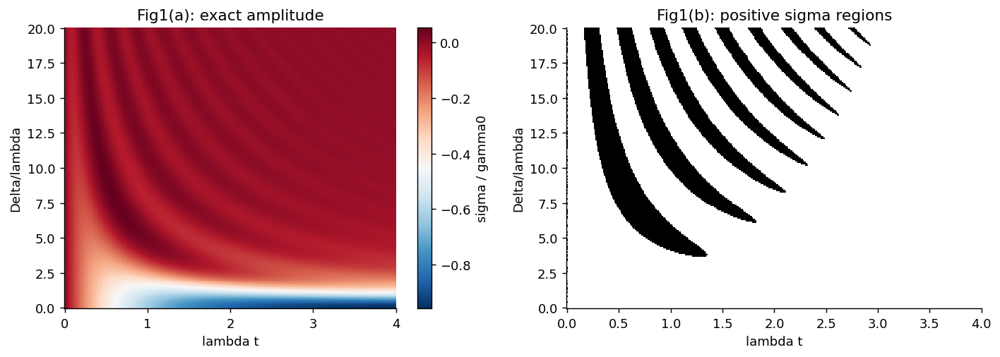
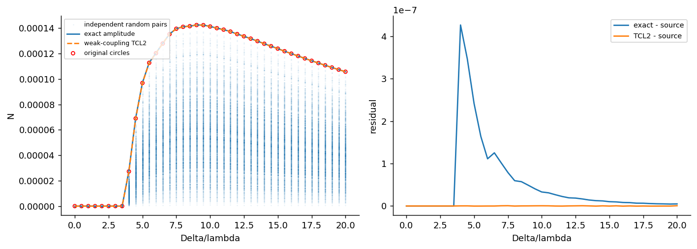

# 0908.0238: Measure for the Degree of Non-Markovian Behavior of Quantum Processes in Open Systems

Preprint: [arXiv:0908.0238v2 — Measure for the Degree of Non-Markovian Behavior of Quantum Processes in Open Systems](https://arxiv.org/abs/0908.0238v2)

Published as: [Measure for the Degree of Non-Markovian Behavior of Quantum Processes in Open Systems](https://doi.org/10.1103/PhysRevLett.103.210401)

Formal citation: Phys. Rev. Lett. 103, 210401 (2009) · DOI `10.1103/PhysRevLett.103.210401` · Locator `210401`

Public status: **Partial scientific reproduction** · Audit score: **Not assessed / 未评分**

信息回流、非马尔可夫性峰值及态对比较得到支持。



## Start Here / 从这里开始

- [中文复现 Note](note/reproduction-note.zh-CN.md)
- [English reproduction note](note/reproduction-note.en.md)
- [简短图文报告 / Illustrated report](docs/report/index.html)
- [推导 / Derivation](docs/DERIVATION.md)
- [复算与范围 / Rerun and scope](docs/NUMERICAL_METHODS.md)
- [Code and run commands](code/README.md)
- [Machine-readable scorecard](outputs/checks/similarity_scorecard.json)
- [Machine-readable completion boundary](outputs/checks/completion_assessment.json)
- [Derivation (equations)](docs/DERIVATION.md)
- [Numerical methods](docs/NUMERICAL_METHODS.md)
- [Lessons learned](docs/LESSONS_LEARNED.md)

## Main Reproduced Results

| Paper item | Reproduced result | Figure | Check |
| --- | --- | --- | --- |
| Declared source targets | 信息回流、非马尔可夫性峰值及态对比较得到支持。 | [PNG](outputs/figures/fig1-independent.png) | [JSON](outputs/checks/numerical-checks.json) |

## Paper Reference vs Independent Reproduction

Comparison reference: Phys. Rev. Lett. 103, 210401 (2009), Measure for the Degree of Non-Markovian Behavior of Quantum Processes in Open Systems, DOI 10.1103/PhysRevLett.103.210401; fixed source 0908.0238v2. Colored curves/maps are independent calculations; any source marks are limited validation excerpts, excluded from the repository content license. Graphic agreement does not establish author-array equality. Original figures and digitized source point sets are not redistributed.

### fig2-independent.png comparison



### Declared source targets: 信息回流、非马尔可夫性峰值及态对比较得到支持。


## Quick Run

```bash
python -m venv .venv
source .venv/bin/activate
pip install -r cases/0908.0238/code/requirements.txt
cd cases/0908.0238/code
python scripts/run_reproduction.py
```

Published machine-readable artifacts are kept under [data](outputs/data/), [figures](outputs/figures/), [checks](outputs/checks/).

## Reproduction Boundary

This public case includes paper-derived code, generated data, generated figures, public validation checks, explanatory notes, and 1 limited comparison panels. Those panels use the minimum paper excerpts needed for validation and clearly separate the paper reference from the independent result. The case does not redistribute the paper PDF, arXiv source archive, standalone original figures, EPS paths, digitized source curves, or source-derived point sets.

Remaining limitation: 网格投影与近似阶次的残差仍需区分，未将量化对比完成当作整图完全一致。

Final-parameter rule: final public figures use the paper parameters when feasible. Any reduced-scale, subset, proxy, or blocked target must be labeled explicitly and cannot be presented as a complete reproduction.
