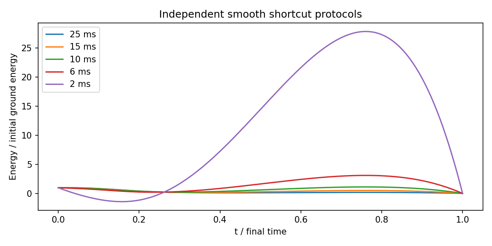
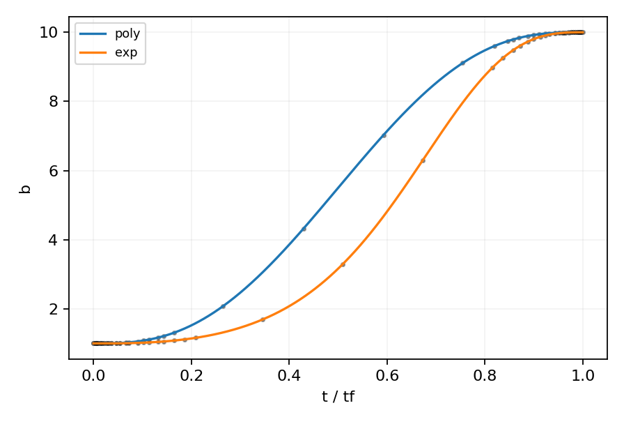
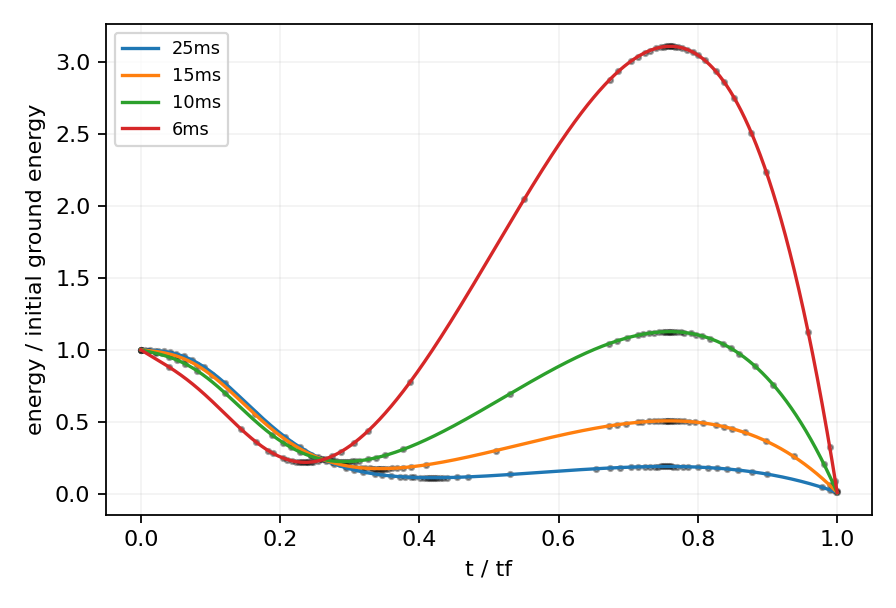
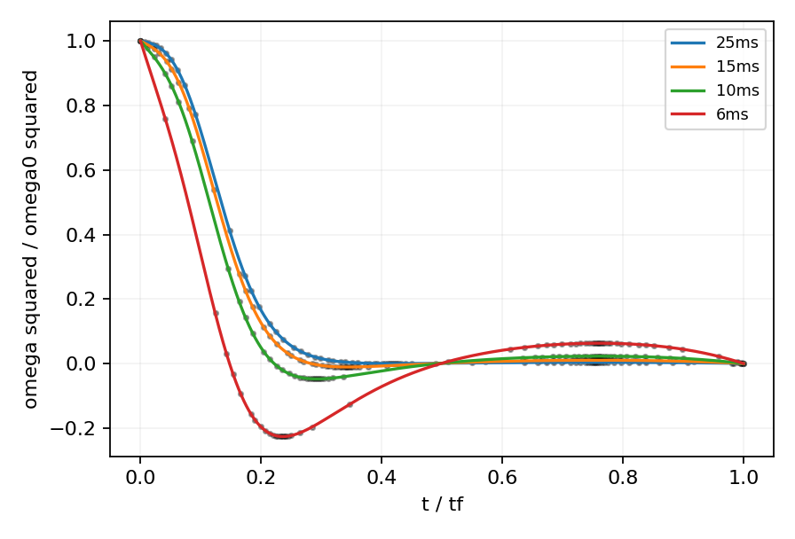
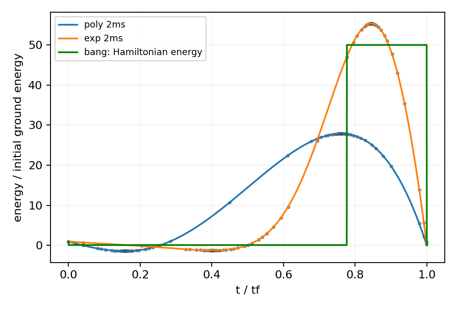
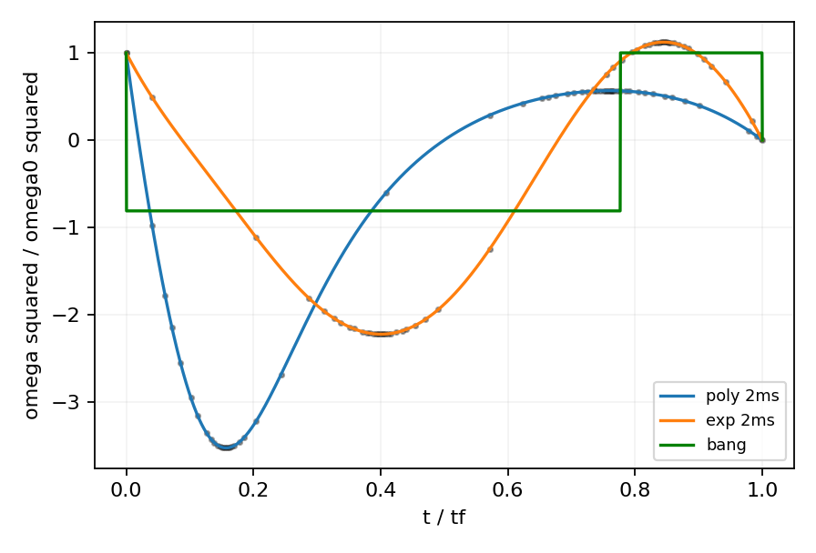
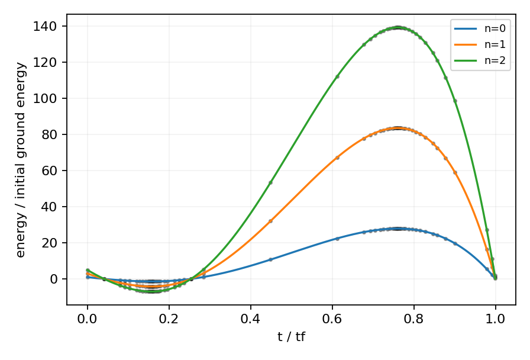
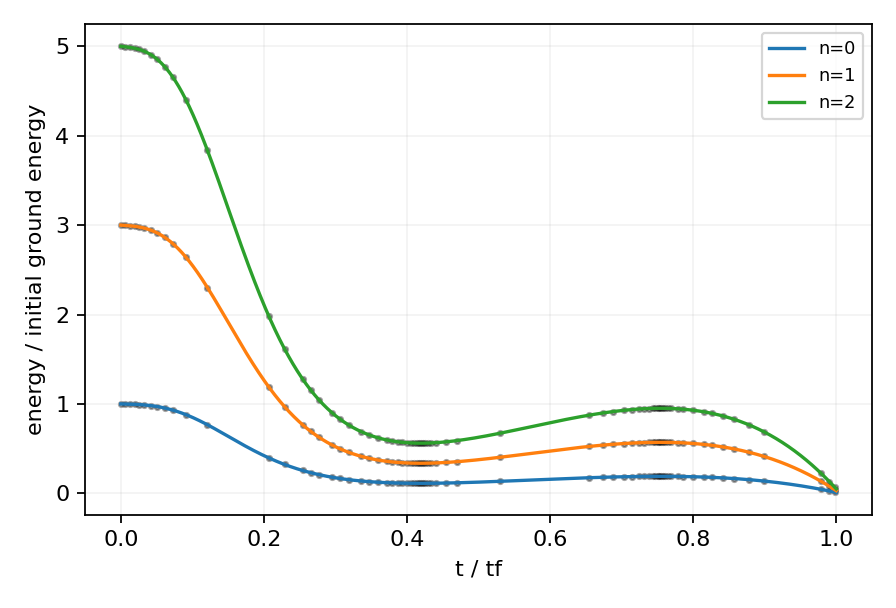

# 0910.0709: Fast Optimal Frictionless Atom Cooling in Harmonic Traps: Shortcut to Adiabaticity

Preprint: [arXiv:0910.0709v1 — Fast Optimal Frictionless Atom Cooling in Harmonic Traps: Shortcut to Adiabaticity](https://arxiv.org/abs/0910.0709v1)

Published as: [Fast Optimal Frictionless Atom Cooling in Harmonic Traps: Shortcut to Adiabaticity](https://doi.org/10.1103/PhysRevLett.104.063002)

Formal citation: Phys. Rev. Lett. 104, 063002 (2010) · DOI `10.1103/PhysRevLett.104.063002` · Locator `063002`

Public status: **Partial scientific reproduction** · Audit score: **Not assessed / 未评分**

主要冷却结果与原图光滑曲线高度一致；bang-bang 能量显示仍需核对。



## Start Here / 从这里开始

- [中文复现 Note](note/reproduction-note.zh-CN.md)
- [English reproduction note](note/reproduction-note.en.md)
- [简短图文报告 / Illustrated report](docs/report/index.html)
- [推导 / Derivation](docs/DERIVATION.md)
- [复算与范围 / Rerun and scope](docs/NUMERICAL_METHODS.md)
- [Code and run commands](code/README.md)
- [Machine-readable scorecard](outputs/checks/similarity_scorecard.json)
- [Machine-readable completion boundary](outputs/checks/completion_assessment.json)
- [Derivation (equations)](docs/DERIVATION.md)
- [Numerical methods](docs/NUMERICAL_METHODS.md)
- [Lessons learned](docs/LESSONS_LEARNED.md)

## Main Reproduced Results

| Paper item | Reproduced result | Figure | Check |
| --- | --- | --- | --- |
| Declared source targets | 主要冷却结果与原图光滑曲线高度一致；bang-bang 能量显示仍需核对。 | [PNG](outputs/figures/overview.png) | [JSON](outputs/checks/numerical-checks.json) |

## Paper Reference vs Independent Reproduction

Comparison reference: Phys. Rev. Lett. 104, 063002 (2010), Fast Optimal Frictionless Atom Cooling in Harmonic Traps: Shortcut to Adiabaticity, DOI 10.1103/PhysRevLett.104.063002; fixed source 0910.0709v1. Colored curves/maps are independent calculations; any source marks are limited validation excerpts, excluded from the repository content license. Graphic agreement does not establish author-array equality. Original figures and digitized source point sets are not redistributed.

### fig1-reproduced.png comparison



### fig2a-reproduced.png comparison



### fig2b-reproduced.png comparison



### fig3a-reproduced.png comparison



### fig3b-reproduced.png comparison



### fig4a-reproduced.png comparison



### fig4b-reproduced.png comparison



### Declared source targets: 主要冷却结果与原图光滑曲线高度一致；bang-bang 能量显示仍需核对。


## Quick Run

```bash
python -m venv .venv
source .venv/bin/activate
pip install -r cases/0910.0709/code/requirements.txt
cd cases/0910.0709/code
python scripts/run_reproduction.py
```

Published machine-readable artifacts are kept under [data](outputs/data/), [figures](outputs/figures/), [checks](outputs/checks/).

## Reproduction Boundary

This public case includes paper-derived code, generated data, generated figures, public validation checks, explanatory notes, and 7 limited comparison panels. Those panels use the minimum paper excerpts needed for validation and clearly separate the paper reference from the independent result. The case does not redistribute the paper PDF, arXiv source archive, standalone original figures, EPS paths, digitized source curves, or source-derived point sets.

Remaining limitation: 同一连续状态与给定H的绿色第二平台由代数和直接波函数传播一致给50.005；原图平台1的实际绘图量尚未恢复。保留条件性不相容，不推断作者重置状态。

Final-parameter rule: final public figures use the paper parameters when feasible. Any reduced-scale, subset, proxy, or blocked target must be labeled explicitly and cannot be presented as a complete reproduction.
