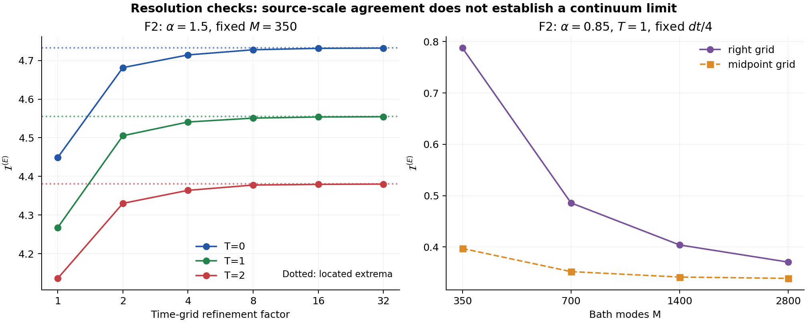
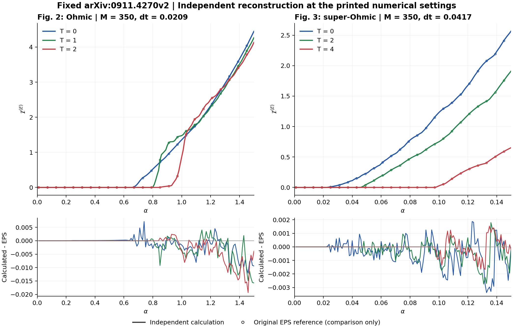

# 0911.4270: Measuring non-Markovianity with entanglement

Preprint: [0911.4270v3 — Measuring non-Markovianity with entanglement](https://arxiv.org/abs/0911.4270)

Formal publication: **Not recorded as of 2026-10-24**

Public status: **Scientific reproduction — main physical results reproduced** · Audit score: **Not assessed / 未评分**

系统和环境纠缠回升、CP 可分性失效Witness、GKSL 构造和时间离散控制得到独立支持。



## Start Here / 从这里开始

- [中文复现 Note](note/reproduction-note.zh-CN.md)
- [English reproduction note](note/reproduction-note.en.md)
- [Final same-agent report](docs/FINAL-REPORT.md)
- [Numerical methods and rerun scope](docs/NUMERICAL_METHODS.md)
- [Recorded boundaries](docs/LESSONS_LEARNED.md)
- [Code and run commands](code/README.md)
- [Machine-readable scorecard](outputs/checks/similarity_scorecard.json)
- [Machine-readable completion boundary](outputs/checks/completion_assessment.json)
- [Derivation (equations)](docs/DERIVATION.md)
- [Numerical methods](docs/NUMERICAL_METHODS.md)
- [Lessons learned](docs/LESSONS_LEARNED.md)

## Main Reproduced Results

| Paper item | Reproduced result | Figure | Check |
| --- | --- | --- | --- |
| Declared source targets | 系统和环境纠缠回升、CP 可分性失效Witness、GKSL 构造和时间离散控制得到独立支持。 | [PNG](outputs/figures/resolution_checks.png) | [JSON](outputs/checks/numerical-checks.json) |

## Paper Reference vs Independent Reproduction

Comparison reference: arXiv:0911.4270v3. Panels contain independently generated results and any limited attributed source marks are excluded from repository content license. Visual agreement does not establish author-data equality; original figures and digitized point sets are not redistributed.

### source_comparison comparison



### Declared source targets: 系统和环境纠缠回升、CP 可分性失效Witness、GKSL 构造和时间离散控制得到独立支持。


## Quick Run

```bash
python -m venv .venv
source .venv/bin/activate
pip install -r cases/0911.4270/code/requirements.txt
cd cases/0911.4270/code
python scripts/run_reproduction.py
```

Published machine-readable artifacts are kept under [data](outputs/data/), [figures](outputs/figures/), [checks](outputs/checks/).

## Reproduction Boundary

This public case includes paper-derived code, generated data, generated figures, public validation checks, explanatory notes, and 1 limited comparison panels. Those panels use the minimum paper excerpts needed for validation and clearly separate the paper reference from the independent result. The case does not redistribute the paper PDF, arXiv source archive, standalone original figures, EPS paths, digitized source curves, or source-derived point sets.

Remaining limitation: 数值和解析控制支持声明范围；Witness 是充分性判据，不排除所有不可分演化。

Final-parameter rule: final public figures use the paper parameters when feasible. Any reduced-scale, subset, proxy, or blocked target must be labeled explicitly and cannot be presented as a complete reproduction.
