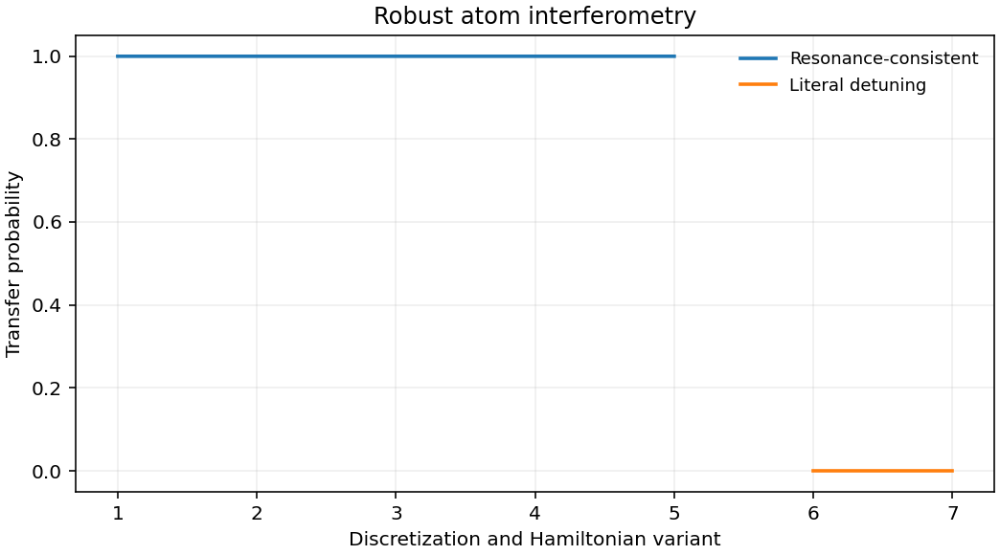

# 10.1038-s41467-023-43374-0: Enhancing the sensitivity of atom-interferometric inertial sensors using robust control

Preprint: [arXiv:2303.03683v3 — Enhancing the sensitivity of atom-interferometric inertial sensors using robust control](https://arxiv.org/abs/2303.03683v3)

Published as: [Enhancing the sensitivity of atom-interferometric inertial sensors using robust control](https://doi.org/10.1038/s41467-023-43374-0)

Formal citation: Nat. Commun. 14, 7626 (2023) · DOI `10.1038/s41467-023-43374-0` · Locator `7626`

Public status: **Partial scientific reproduction** · Audit score: **Not assessed / 未评分**

作者处理后的数据重分析给出图 3 和图 4 的最大精度提升 9.950 倍和 21.108 倍。独立动量态传播检验了布拉格共振、投影算子和加速度灵敏度积分。



## Start Here / 从这里开始

- [中文复现 Note](note/reproduction-note.zh-CN.md)
- [English reproduction note](note/reproduction-note.en.md)
- [推导 / Derivation](docs/DERIVATION.md)
- [复算 / Rerun](docs/NUMERICAL_METHODS.md)
- [资料缺口 / Data availability](docs/DATA-AVAILABILITY.md)
- [Code and run commands](code/README.md)
- [Machine-readable scorecard](outputs/checks/similarity_scorecard.json)
- [Machine-readable completion boundary](outputs/checks/completion_assessment.json)
- [Derivation (equations)](docs/DERIVATION.md)
- [Numerical methods](docs/NUMERICAL_METHODS.md)
- [Lessons learned](docs/LESSONS_LEARNED.md)

## Main Reproduced Results

| Paper item | Reproduced result | Figure | Check |
| --- | --- | --- | --- |
| Figures 3–4 precision and multistate dynamics | 作者处理后的数据重分析给出图 3 和图 4 的最大精度提升 9.950 倍和 21.108 倍。独立动量态传播检验了布拉格共振、投影算子和加速度灵敏度积分。 | [PNG](outputs/figures/overview.png) | [JSON](outputs/checks/numerical-checks.json) |

### Figures 3–4 precision and multistate dynamics: 作者处理后的数据重分析给出图 3 和图 4 的最大精度提升 9.950 倍和 21.108 倍。独立动量态传播检验了布拉格共振、投影算子和加速度灵敏度积分。


## Quick Run

```bash
python -m venv .venv
source .venv/bin/activate
pip install -r cases/10.1038-s41467-023-43374-0/code/requirements.txt
cd cases/10.1038-s41467-023-43374-0/code
python scripts/run_reproduction.py
```

Published machine-readable artifacts are kept under [data](outputs/data/), [figures](outputs/figures/), [checks](outputs/checks/).

## Reproduction Boundary

This public case includes paper-derived code, generated data, generated figures, public validation checks, explanatory notes. It does not redistribute the paper PDF, arXiv source archive, original figures, EPS paths, digitized source curves, source-derived point sets, or source-vs-generated composite panels.

Remaining limitation: 公开入口复跑模型核查。原始条纹、加速度记录、优化波形及实验校准仍缺，标度因子差异保留。

Final-parameter rule: final public figures use the paper parameters when feasible. Any reduced-scale, subset, proxy, or blocked target must be labeled explicitly and cannot be presented as a complete reproduction.
