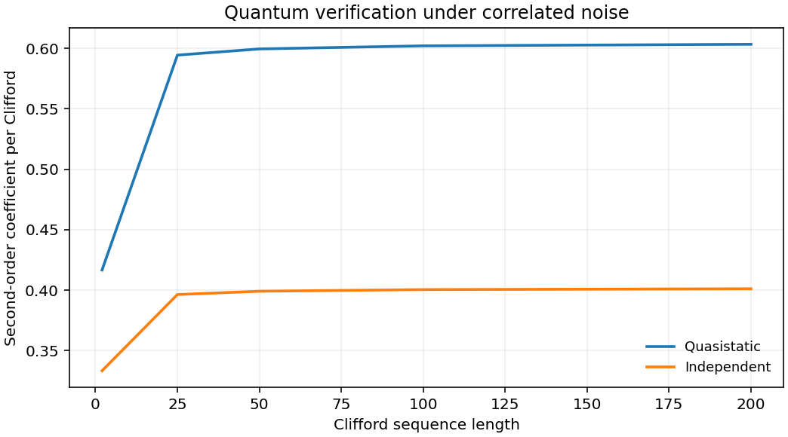

# 10.1038-s41534-017-0052-0: Experimental quantum verification in the presence of temporally correlated noise

Preprint: [arXiv:1706.03787 — Experimental quantum verification in the presence of temporally correlated noise](https://arxiv.org/abs/1706.03787)

Published as: [Experimental quantum verification in the presence of temporally correlated noise](https://doi.org/10.1038/s41534-017-0052-0)

Formal citation: npj Quantum Inf. 4, 7 (2018) · DOI `10.1038/s41534-017-0052-0` · Locator `7`

Public status: **Partial scientific reproduction** · Audit score: **Not assessed / 未评分**

独立传播支持相关噪声产生宽而偏斜的 RB 分布。17 组公开 GST 数据已重拟合，五个主要失谐条件的 15 个半钻石范数均在论文打印区间内。保留补充表 S2 的 DC 系数差异。



## Start Here / 从这里开始

- [中文复现 Note](note/reproduction-note.zh-CN.md)
- [English reproduction note](note/reproduction-note.en.md)
- [推导 / Derivation](docs/DERIVATION.md)
- [复算 / Rerun](docs/NUMERICAL_METHODS.md)
- [资料缺口 / Data availability](docs/DATA-AVAILABILITY.md)
- [Code and run commands](code/README.md)
- [Machine-readable scorecard](outputs/checks/similarity_scorecard.json)
- [Machine-readable completion boundary](outputs/checks/completion_assessment.json)
- [Derivation (equations)](docs/DERIVATION.md)
- [Numerical methods](docs/NUMERICAL_METHODS.md)
- [Lessons learned](docs/LESSONS_LEARNED.md)

## Main Reproduced Results

| Paper item | Reproduced result | Figure | Check |
| --- | --- | --- | --- |
| Randomized benchmarking and public GST data | 独立传播支持相关噪声产生宽而偏斜的 RB 分布。17 组公开 GST 数据已重拟合，五个主要失谐条件的 15 个半钻石范数均在论文打印区间内。保留补充表 S2 的 DC 系数差异。 | [PNG](outputs/figures/overview.png) | [JSON](outputs/checks/numerical-checks.json) |

### Randomized benchmarking and public GST data: 独立传播支持相关噪声产生宽而偏斜的 RB 分布。17 组公开 GST 数据已重拟合，五个主要失谐条件的 15 个半钻石范数均在论文打印区间内。保留补充表 S2 的 DC 系数差异。


## Quick Run

```bash
python -m venv .venv
source .venv/bin/activate
pip install -r cases/10.1038-s41534-017-0052-0/code/requirements.txt
cd cases/10.1038-s41534-017-0052-0/code
python scripts/run_reproduction.py
```

Published machine-readable artifacts are kept under [data](outputs/data/), [figures](outputs/figures/), [checks](outputs/checks/).

## Reproduction Boundary

This public case includes paper-derived code, generated data, generated figures, public validation checks, explanatory notes. It does not redistribute the paper PDF, arXiv source archive, original figures, EPS paths, digitized source curves, source-derived point sets, or source-vs-generated composite panels.

Remaining limitation: 原始 RB 和探测记录、实际实验约定以及原 Hessian 区间仍待核对。公开入口重算有限状态 RB 矩，GST 原计数沿用作者入口。

Final-parameter rule: final public figures use the paper parameters when feasible. Any reduced-scale, subset, proxy, or blocked target must be labeled explicitly and cannot be presented as a complete reproduction.
