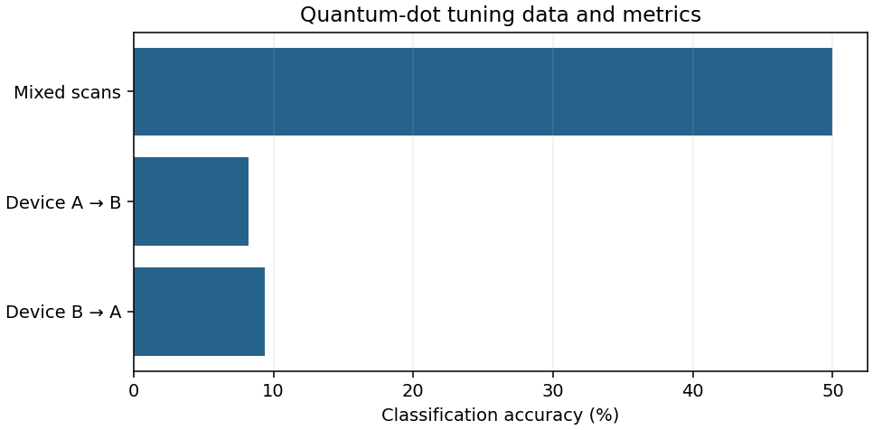

# 10.1038-s41534-024-00878-x: Data needs and challenges for quantum dot devices automation

Preprint: **No preprint recorded as of 2026-11-15**

Published as: [Data needs and challenges for quantum dot devices automation](https://doi.org/10.1038/s41534-024-00878-x)

Formal citation: npj Quantum Inf 10, 105 (2024) · DOI `10.1038/s41534-024-00878-x` · Locator `105`

Public status: **Partial scientific reproduction** · Audit score: **Not assessed / 未评分**

复核会议报告关联的 QFlow 数据。756 张实测扫图中，混合留出准确率 50.00%，跨两个器件留出分别为 8.19% 和 9.40%。



## Start Here / 从这里开始

- [中文复现 Note](note/reproduction-note.zh-CN.md)
- [English reproduction note](note/reproduction-note.en.md)
- [推导 / Derivation](docs/DERIVATION.md)
- [复算 / Rerun](docs/NUMERICAL_METHODS.md)
- [资料缺口 / Data availability](docs/DATA-AVAILABILITY.md)
- [Code and run commands](code/README.md)
- [Machine-readable scorecard](outputs/checks/similarity_scorecard.json)
- [Machine-readable completion boundary](outputs/checks/completion_assessment.json)
- [Derivation (equations)](docs/DERIVATION.md)
- [Numerical methods](docs/NUMERICAL_METHODS.md)
- [Lessons learned](docs/LESSONS_LEARNED.md)

## Main Reproduced Results

| Paper item | Reproduced result | Figure | Check |
| --- | --- | --- | --- |
| Datasets discussed in the workshop report | 复核会议报告关联的 QFlow 数据。756 张实测扫图中，混合留出准确率 50.00%，跨两个器件留出分别为 8.19% 和 9.40%。 | [PNG](outputs/figures/overview.png) | [JSON](outputs/checks/numerical-checks.json) |

### Datasets discussed in the workshop report: 复核会议报告关联的 QFlow 数据。756 张实测扫图中，混合留出准确率 50.00%，跨两个器件留出分别为 8.19% 和 9.40%。


## Quick Run

```bash
python -m venv .venv
source .venv/bin/activate
pip install -r cases/10.1038-s41534-024-00878-x/code/requirements.txt
cd cases/10.1038-s41534-024-00878-x/code
python scripts/run_reproduction.py
```

Published machine-readable artifacts are kept under [data](outputs/data/), [figures](outputs/figures/), [checks](outputs/checks/).

## Reproduction Boundary

This public case includes paper-derived code, generated data, generated figures, public validation checks, explanatory notes. It does not redistribute the paper PDF, arXiv source archive, original figures, EPS paths, digitized source curves, source-derived point sets, or source-vs-generated composite panels.

Remaining limitation: 原文是会议报告。公开结果复核所引数据与评价方法，在线调谐仍缺动作日志和逐步测量。

Final-parameter rule: final public figures use the paper parameters when feasible. Any reduced-scale, subset, proxy, or blocked target must be labeled explicitly and cannot be presented as a complete reproduction.
