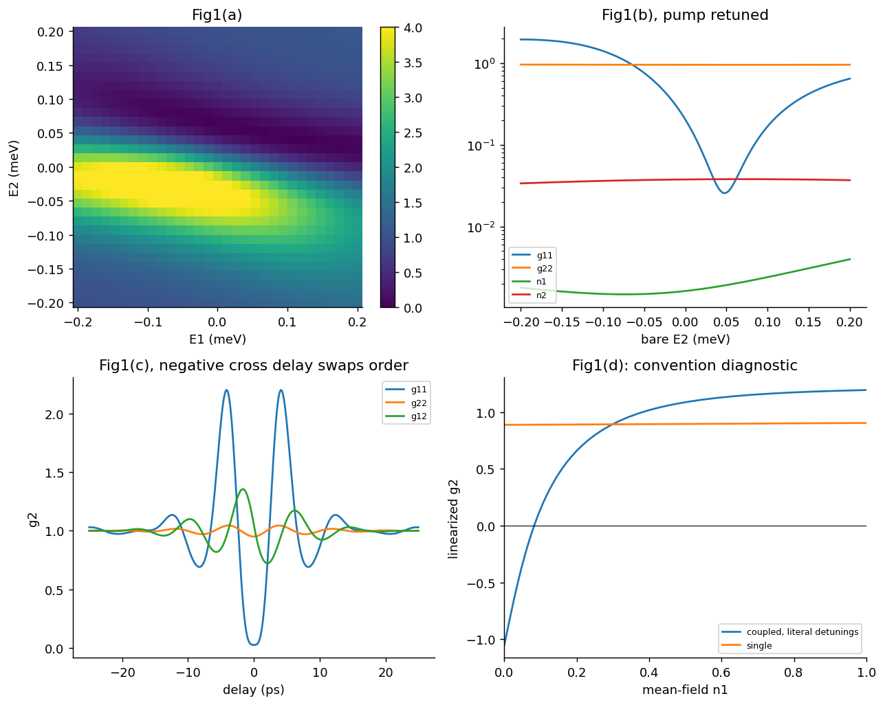
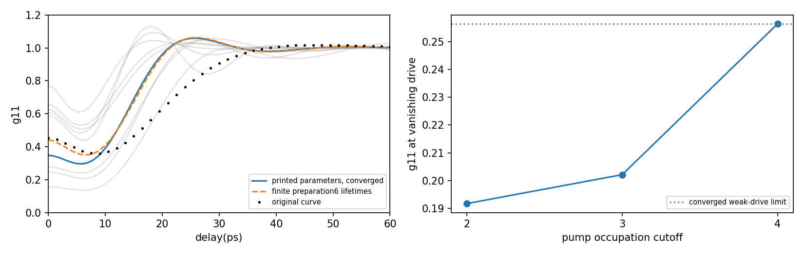

# 1002.4341: Single Photons from Coupled Quantum Modes

Preprint: [arXiv:1002.4341v2 — Single Photons from Coupled Quantum Modes](https://arxiv.org/abs/1002.4341v2)

Published as: [Single Photons from Coupled Quantum Modes](https://doi.org/10.1103/PhysRevLett.104.183601)

Formal citation: Phys. Rev. Lett. 104, 183601 (2010) · DOI `10.1103/PhysRevLett.104.183601` · Locator `183601`

Public status: **Partial scientific reproduction** · Audit score: **Not assessed / 未评分**

两模强反聚束得到支持；三模及高占据曲线还有实质核对工作。



## Start Here / 从这里开始

- [中文复现 Note](note/reproduction-note.zh-CN.md)
- [English reproduction note](note/reproduction-note.en.md)
- [简短图文报告 / Illustrated report](docs/report/index.html)
- [推导 / Derivation](docs/DERIVATION.md)
- [复算与范围 / Rerun and scope](docs/NUMERICAL_METHODS.md)
- [Code and run commands](code/README.md)
- [Machine-readable scorecard](outputs/checks/similarity_scorecard.json)
- [Machine-readable completion boundary](outputs/checks/completion_assessment.json)
- [Derivation (equations)](docs/DERIVATION.md)
- [Numerical methods](docs/NUMERICAL_METHODS.md)
- [Lessons learned](docs/LESSONS_LEARNED.md)

## Main Reproduced Results

| Paper item | Reproduced result | Figure | Check |
| --- | --- | --- | --- |
| Declared source targets | 两模强反聚束得到支持；三模及高占据曲线还有实质核对工作。 | [PNG](outputs/figures/fig1-independent.png) | [JSON](outputs/checks/numerical-checks.json) |

## Paper Reference vs Independent Reproduction

Comparison reference: Phys. Rev. Lett. 104, 183601 (2010), Single Photons from Coupled Quantum Modes, DOI 10.1103/PhysRevLett.104.183601; fixed source 1002.4341v2；已核对公开EPAPS. Colored curves/maps are independent calculations; any source marks are limited validation excerpts, excluded from the repository content license. Graphic agreement does not establish author-array equality. Original figures and digitized source point sets are not redistributed.

### photon-whole-trace-and-cutoff.png comparison



### Declared source targets: 两模强反聚束得到支持；三模及高占据曲线还有实质核对工作。


## Quick Run

```bash
python -m venv .venv
source .venv/bin/activate
pip install -r cases/1002.4341/code/requirements.txt
cd cases/1002.4341/code
python scripts/run_reproduction.py
```

Published machine-readable artifacts are kept under [data](outputs/data/), [figures](outputs/figures/), [checks](outputs/checks/).

## Reproduction Boundary

This public case includes paper-derived code, generated data, generated figures, public validation checks, explanatory notes, and 1 limited comparison panels. Those panels use the minimum paper excerpts needed for validation and clearly separate the paper reference from the independent result. The case does not redistribute the paper PDF, arXiv source archive, standalone original figures, EPS paths, digitized source curves, or source-derived point sets.

Remaining limitation: 三模完整源曲线、正文0.28与源图0.4522尚未统一；源条件收敛g2(0)=0.34699064724。线宽、驱动、截断和有限制备时间控制均未恢复整条曲线。；原正Gaussian曲线和高于已受控占据范围的原条件计算仍未完成；625点热图已经完成，不重复计作待做。

Final-parameter rule: final public figures use the paper parameters when feasible. Any reduced-scale, subset, proxy, or blocked target must be labeled explicitly and cannot be presented as a complete reproduction.
