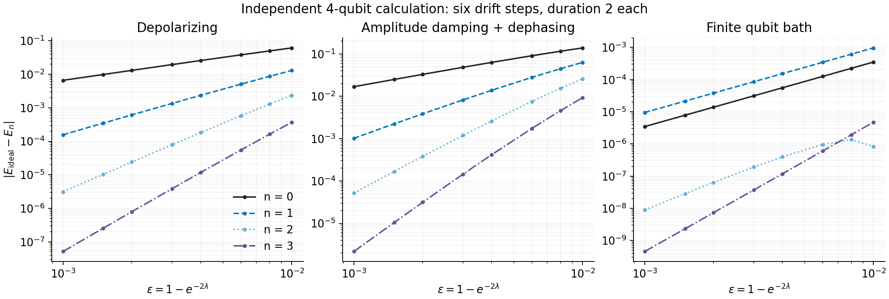
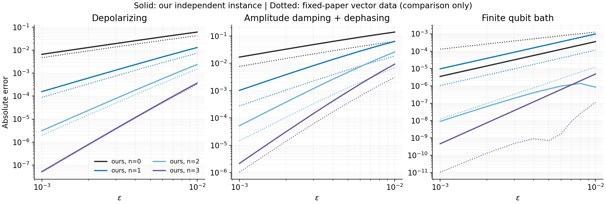

# 1612.02058: Error mitigation for short-depth quantum circuits

Preprint: [1612.02058v3 — Error mitigation for short-depth quantum circuits](https://arxiv.org/abs/1612.02058)

Formal publication: **Not recorded as of 2026-10-24**

Public status: **Partial scientific reproduction** · Audit score: **Not assessed / 未评分**

Richardson 外推、误差取消构造、QPR 协议和分组方差不可能性界得到独立核验。



## Start Here / 从这里开始

- [中文复现 Note](note/reproduction-note.zh-CN.md)
- [English reproduction note](note/reproduction-note.en.md)
- [Final same-agent report](docs/FINAL-REPORT.md)
- [Numerical methods and rerun scope](docs/NUMERICAL_METHODS.md)
- [Recorded boundaries](docs/LESSONS_LEARNED.md)
- [Code and run commands](code/README.md)
- [Machine-readable scorecard](outputs/checks/similarity_scorecard.json)
- [Machine-readable completion boundary](outputs/checks/completion_assessment.json)
- [Derivation (equations)](docs/DERIVATION.md)
- [Numerical methods](docs/NUMERICAL_METHODS.md)
- [Lessons learned](docs/LESSONS_LEARNED.md)

## Main Reproduced Results

| Paper item | Reproduced result | Figure | Check |
| --- | --- | --- | --- |
| Declared source targets | Richardson 外推、误差取消构造、QPR 协议和分组方差不可能性界得到独立核验。 | [PNG](outputs/figures/reproduced_figure1.png) | [JSON](outputs/checks/numerical-checks.json) |

## Paper Reference vs Independent Reproduction

Comparison reference: arXiv:1612.02058v3. Panels contain independently generated results and any limited attributed source marks are excluded from repository content license. Visual agreement does not establish author-data equality; original figures and digitized point sets are not redistributed.

### reference_comparison comparison



### Declared source targets: Richardson 外推、误差取消构造、QPR 协议和分组方差不可能性界得到独立核验。


## Quick Run

```bash
python -m venv .venv
source .venv/bin/activate
pip install -r cases/1612.02058/code/requirements.txt
cd cases/1612.02058/code
python scripts/run_reproduction.py
```

Published machine-readable artifacts are kept under [data](outputs/data/), [figures](outputs/figures/), [checks](outputs/checks/).

## Reproduction Boundary

This public case includes paper-derived code, generated data, generated figures, public validation checks, explanatory notes, and 1 limited comparison panels. Those panels use the minimum paper excerpts needed for validation and clearly separate the paper reference from the independent result. The case does not redistribute the paper PDF, arXiv source archive, standalone original figures, EPS paths, digitized source curves, or source-derived point sets.

Remaining limitation: Fig1a/Fig1b 原始曲线与 Fig2 原始直方图协议缺失，三项原始对象检查保持外部资源受阻。

Final-parameter rule: final public figures use the paper parameters when feasible. Any reduced-scale, subset, proxy, or blocked target must be labeled explicitly and cannot be presented as a complete reproduction.
