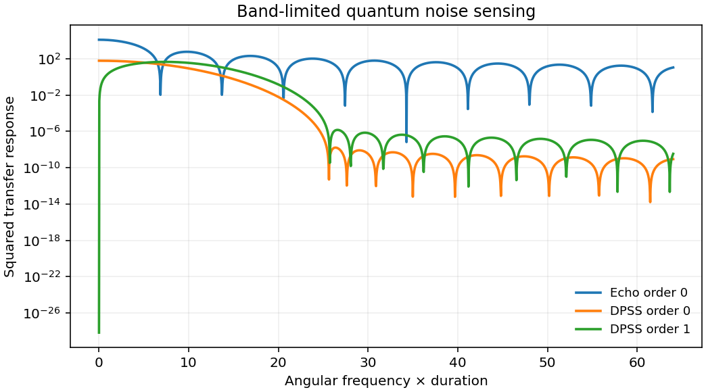

# 1704.02050: Application of optimal band-limited control protocols to quantum noise sensing

Preprint: [arXiv:1704.02050v1 — Application of optimal band-limited control protocols to quantum noise sensing](https://arxiv.org/abs/1704.02050v1)

Published as: [Application of optimal band-limited control protocols to quantum noise sensing](https://doi.org/10.1038/s41467-017-02298-2)

Formal citation: Nat. Commun. 8, 2189 (2017) · DOI `10.1038/s41467-017-02298-2` · Locator `2189`

Public status: **Partial scientific reproduction** · Audit score: **Not assessed / 未评分**

14 个数值面板均有计算或公开数据核对。DPSS 与相位平均重建得到公开九乘四亮态矩阵约 7 kHz 的截止。图 3(c) 的无退相干线与图注深度仍有差异。



## Start Here / 从这里开始

- [中文复现 Note](note/reproduction-note.zh-CN.md)
- [English reproduction note](note/reproduction-note.en.md)
- [推导 / Derivation](docs/DERIVATION.md)
- [复算 / Rerun](docs/NUMERICAL_METHODS.md)
- [资料缺口 / Data availability](docs/DATA-AVAILABILITY.md)
- [Code and run commands](code/README.md)
- [Machine-readable scorecard](outputs/checks/similarity_scorecard.json)
- [Machine-readable completion boundary](outputs/checks/completion_assessment.json)
- [Derivation (equations)](docs/DERIVATION.md)
- [Numerical methods](docs/NUMERICAL_METHODS.md)
- [Lessons learned](docs/LESSONS_LEARNED.md)

## Main Reproduced Results

| Paper item | Reproduced result | Figure | Check |
| --- | --- | --- | --- |
| DPSS concentration, tomography and spectral estimates | 14 个数值面板均有计算或公开数据核对。DPSS 与相位平均重建得到公开九乘四亮态矩阵约 7 kHz 的截止。图 3(c) 的无退相干线与图注深度仍有差异。 | [PNG](outputs/figures/overview.png) | [JSON](outputs/checks/numerical-checks.json) |

### DPSS concentration, tomography and spectral estimates: 14 个数值面板均有计算或公开数据核对。DPSS 与相位平均重建得到公开九乘四亮态矩阵约 7 kHz 的截止。图 3(c) 的无退相干线与图注深度仍有差异。


## Quick Run

```bash
python -m venv .venv
source .venv/bin/activate
pip install -r cases/1704.02050/code/requirements.txt
cd cases/1704.02050/code
python scripts/run_reproduction.py
```

Published machine-readable artifacts are kept under [data](outputs/data/), [figures](outputs/figures/), [checks](outputs/checks/).

## Reproduction Boundary

This public case includes paper-derived code, generated data, generated figures, public validation checks, explanatory notes. It does not redistribute the paper PDF, arXiv source archive, original figures, EPS paths, digitized source curves, source-derived point sets, or source-vs-generated composite panels.

Remaining limitation: 逐次计数、实际控制和绝对谱幅校准缺失。公开入口复跑 DPSS 集中度和独立合成谱估计。

Final-parameter rule: final public figures use the paper parameters when feasible. Any reduced-scale, subset, proxy, or blocked target must be labeled explicitly and cannot be presented as a complete reproduction.
