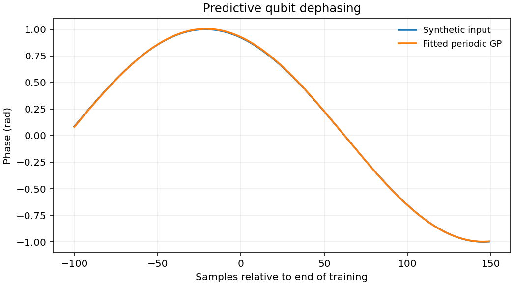

# 1712.01291: Machine Learning for Predictive Estimation of Qubit Dynamics Subject to Dephasing

Preprint: [arXiv:1712.01291v1 — Machine learning for predictive estimation of qubit dynamics subject to dephasing](https://arxiv.org/abs/1712.01291v1)

Published as: [Machine Learning for Predictive Estimation of Qubit Dynamics Subject to Dephasing](https://doi.org/10.1103/physrevapplied.9.064042)

Formal citation: Phys. Rev. Applied 9, 064042 (2018) · DOI `10.1103/physrevapplied.9.064042` · Locator `064042`

Public status: **Partial scientific reproduction** · Audit score: **Not assessed / 未评分**

图 4–9 的 29 个数值面板均有计算。重新扫描图 6 的 600 个候选仍未恢复 LKFFB 的低损失交集。图 9 的周期 GP 后验按核周期重复，独立 Born 控制显示图 8 的前向风险可改善。



## Start Here / 从这里开始

- [中文复现 Note](note/reproduction-note.zh-CN.md)
- [English reproduction note](note/reproduction-note.en.md)
- [推导 / Derivation](docs/DERIVATION.md)
- [复算 / Rerun](docs/NUMERICAL_METHODS.md)
- [资料缺口 / Data availability](docs/DATA-AVAILABILITY.md)
- [Code and run commands](code/README.md)
- [Machine-readable scorecard](outputs/checks/similarity_scorecard.json)
- [Machine-readable completion boundary](outputs/checks/completion_assessment.json)
- [Derivation (equations)](docs/DERIVATION.md)
- [Numerical methods](docs/NUMERICAL_METHODS.md)
- [Lessons learned](docs/LESSONS_LEARNED.md)

## Main Reproduced Results

| Paper item | Reproduced result | Figure | Check |
| --- | --- | --- | --- |
| Figures 4–9 with periodic prediction | 图 4–9 的 29 个数值面板均有计算。重新扫描图 6 的 600 个候选仍未恢复 LKFFB 的低损失交集。图 9 的周期 GP 后验按核周期重复，独立 Born 控制显示图 8 的前向风险可改善。 | [PNG](outputs/figures/overview.png) | [JSON](outputs/checks/numerical-checks.json) |

### Figures 4–9 with periodic prediction: 图 4–9 的 29 个数值面板均有计算。重新扫描图 6 的 600 个候选仍未恢复 LKFFB 的低损失交集。图 9 的周期 GP 后验按核周期重复，独立 Born 控制显示图 8 的前向风险可改善。


## Quick Run

```bash
python -m venv .venv
source .venv/bin/activate
pip install -r cases/1712.01291/code/requirements.txt
cd cases/1712.01291/code
python scripts/run_reproduction.py
```

Published machine-readable artifacts are kept under [data](outputs/data/), [figures](outputs/figures/), [checks](outputs/checks/).

## Reproduction Boundary

This public case includes paper-derived code, generated data, generated figures, public validation checks, explanatory notes. It does not redistribute the paper PDF, arXiv source archive, original figures, EPS paths, digitized source curves, source-derived point sets, or source-vs-generated composite panels.

Remaining limitation: 原模拟轨迹、训练配置与调参档案缺失。全案保留冻结检查点，公开入口重算周期 GP，其他预测器的原条件仍有差异。

Final-parameter rule: final public figures use the paper parameters when feasible. Any reduced-scale, subset, proxy, or blocked target must be labeled explicitly and cannot be presented as a complete reproduction.
