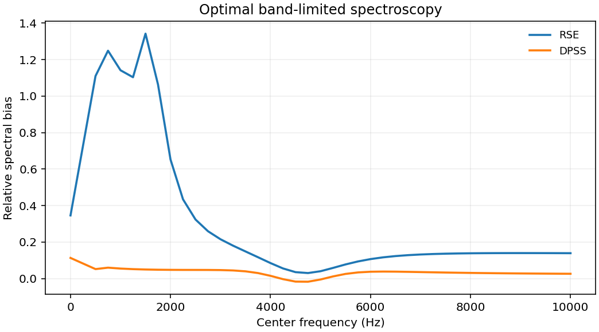

# 1803.05538: Optimally band-limited spectroscopy of control noise using a qubit sensor

Preprint: [arXiv:1803.05538v2 — Optimally band-limited spectroscopy of control noise using a qubit sensor](https://arxiv.org/abs/1803.05538v2)

Published as: [Optimally band-limited spectroscopy of control noise using a qubit sensor](https://doi.org/10.1103/physreva.98.032315)

Formal citation: Phys. Rev. A 98, 032315 (2018) · DOI `10.1103/physreva.98.032315` · Locator `032315`

Public status: **Partial scientific reproduction** · Audit score: **Not assessed / 未评分**

11 张图都有独立重建。偏心洛伦兹谱的低频最大偏差从 134.2% 降至 11.28%，后验峰幅仍差约 9%。图 11 的精确高斯损失约 0.3631，二阶信号约 0.6475。



## Start Here / 从这里开始

- [中文复现 Note](note/reproduction-note.zh-CN.md)
- [English reproduction note](note/reproduction-note.en.md)
- [推导 / Derivation](docs/DERIVATION.md)
- [复算 / Rerun](docs/NUMERICAL_METHODS.md)
- [资料缺口 / Data availability](docs/DATA-AVAILABILITY.md)
- [Code and run commands](code/README.md)
- [Machine-readable scorecard](outputs/checks/similarity_scorecard.json)
- [Machine-readable completion boundary](outputs/checks/completion_assessment.json)
- [Derivation (equations)](docs/DERIVATION.md)
- [Numerical methods](docs/NUMERICAL_METHODS.md)
- [Lessons learned](docs/LESSONS_LEARNED.md)

## Main Reproduced Results

| Paper item | Reproduced result | Figure | Check |
| --- | --- | --- | --- |
| DPSS filters, adaptive estimation and narrow-line limits | 11 张图都有独立重建。偏心洛伦兹谱的低频最大偏差从 134.2% 降至 11.28%，后验峰幅仍差约 9%。图 11 的精确高斯损失约 0.3631，二阶信号约 0.6475。 | [PNG](outputs/figures/overview.png) | [JSON](outputs/checks/numerical-checks.json) |

### DPSS filters, adaptive estimation and narrow-line limits: 11 张图都有独立重建。偏心洛伦兹谱的低频最大偏差从 134.2% 降至 11.28%，后验峰幅仍差约 9%。图 11 的精确高斯损失约 0.3631，二阶信号约 0.6475。


## Quick Run

```bash
python -m venv .venv
source .venv/bin/activate
pip install -r cases/1803.05538/code/requirements.txt
cd cases/1803.05538/code
python scripts/run_reproduction.py
```

Published machine-readable artifacts are kept under [data](outputs/data/), [figures](outputs/figures/), [checks](outputs/checks/).

## Reproduction Boundary

This public case includes paper-derived code, generated data, generated figures, public validation checks, explanatory notes. It does not redistribute the paper PDF, arXiv source archive, original figures, EPS paths, digitized source curves, source-derived point sets, or source-vs-generated composite panels.

Remaining limitation: 同期参数和原始模拟轨迹未取得。保留 SIN 交叉项和标量高斯似然符号差异。

Final-parameter rule: final public figures use the paper parameters when feasible. Any reduced-scale, subset, proxy, or blocked target must be labeled explicitly and cannot be presented as a complete reproduction.
