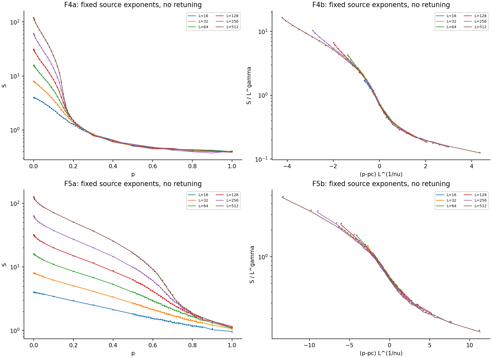
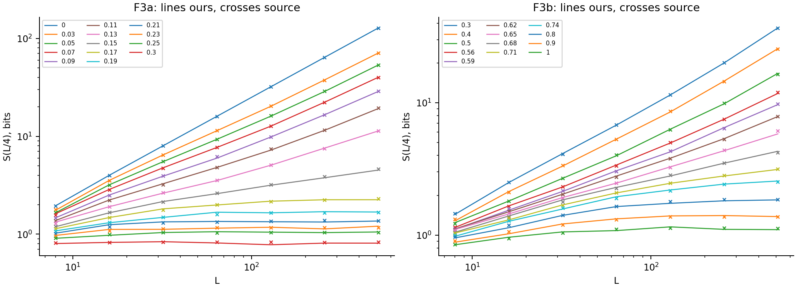
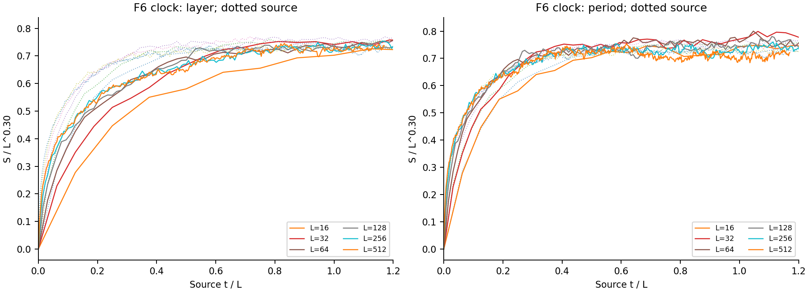
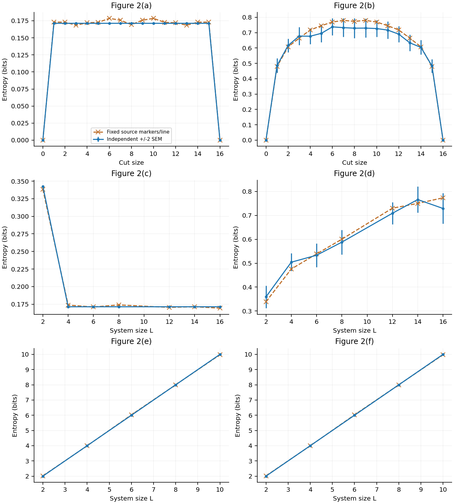

# 1808.06134: Measurement-induced phase transition in the dynamics of entanglement

Preprint: [1808.06134v2 — Measurement-induced phase transition in the dynamics of entanglement](https://arxiv.org/abs/1808.06134)

Formal publication: **Not recorded as of 2026-10-24**

Public status: **Partial scientific reproduction** · Audit score: **Not assessed / 未评分**

监测线路的面积律轨迹纠缠、体积律-面积律转变、Clifford/Haar 对照和有限尺寸塌缩得到大规模独立计算。



## Start Here / 从这里开始

- [中文复现 Note](note/reproduction-note.zh-CN.md)
- [English reproduction note](note/reproduction-note.en.md)
- [Final same-agent report](docs/FINAL-REPORT.md)
- [Numerical methods and rerun scope](docs/NUMERICAL_METHODS.md)
- [Recorded boundaries](docs/LESSONS_LEARNED.md)
- [Code and run commands](code/README.md)
- [Machine-readable scorecard](outputs/checks/similarity_scorecard.json)
- [Machine-readable completion boundary](outputs/checks/completion_assessment.json)
- [Derivation (equations)](docs/DERIVATION.md)
- [Numerical methods](docs/NUMERICAL_METHODS.md)
- [Lessons learned](docs/LESSONS_LEARNED.md)

## Main Reproduced Results

| Paper item | Reproduced result | Figure | Check |
| --- | --- | --- | --- |
| Declared source targets | 监测线路的面积律轨迹纠缠、体积律-面积律转变、Clifford/Haar 对照和有限尺寸塌缩得到大规模独立计算。 | [PNG](outputs/figures/static_collapse.png) | [JSON](outputs/checks/numerical-checks.json) |

## Paper Reference vs Independent Reproduction

Comparison reference: arXiv:1808.06134v2. Panels contain independently generated results and any limited attributed source marks are excluded from repository content license. Visual agreement does not establish author-data equality; original figures and digitized point sets are not redistributed.

### phase_comparison comparison



### dynamic_comparison comparison



### haar_comparison comparison



### Declared source targets: 监测线路的面积律轨迹纠缠、体积律-面积律转变、Clifford/Haar 对照和有限尺寸塌缩得到大规模独立计算。


## Quick Run

```bash
python -m venv .venv
source .venv/bin/activate
pip install -r cases/1808.06134/code/requirements.txt
cd cases/1808.06134/code
python scripts/run_reproduction.py
```

Published machine-readable artifacts are kept under [data](outputs/data/), [figures](outputs/figures/), [checks](outputs/checks/).

## Reproduction Boundary

This public case includes paper-derived code, generated data, generated figures, public validation checks, explanatory notes, and 3 limited comparison panels. Those panels use the minimum paper excerpts needed for validation and clearly separate the paper reference from the independent result. The case does not redistribute the paper PDF, arXiv source archive, standalone original figures, EPS paths, digitized source curves, or source-derived point sets.

Remaining limitation: F4b/F5b/F6 的原始渐近参数不可由有效指数或唯一根区间识别；z=1 保持可容许但未确定。

Final-parameter rule: final public figures use the paper parameters when feasible. Any reduced-scale, subset, proxy, or blocked target must be labeled explicitly and cannot be presented as a complete reproduction.
