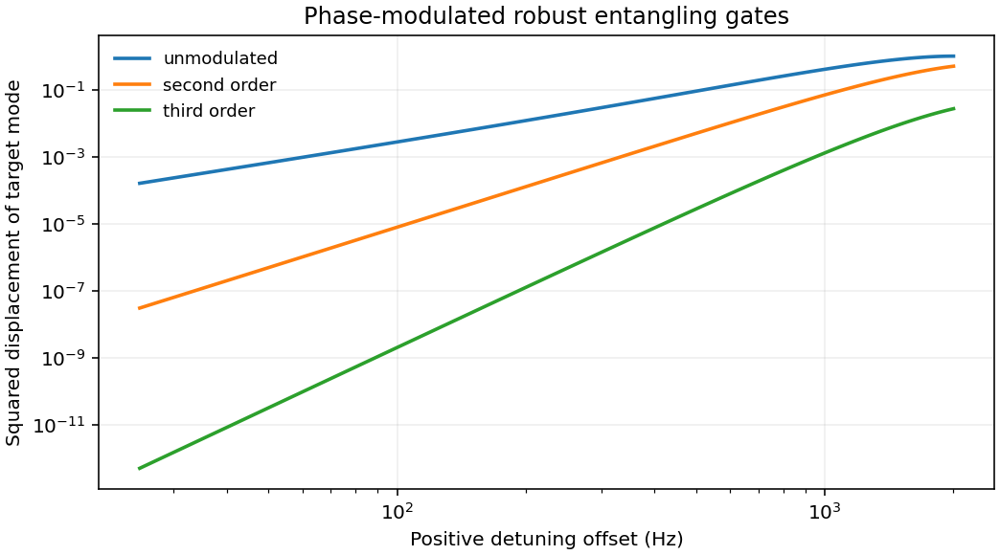

# 1808.10462: Phase-Modulated Entangling Gates Robust to Static and Time-Varying Errors

Preprint: [arXiv:1808.10462v3 — Phase-modulated entangling gates robust to static and time-varying errors](https://arxiv.org/abs/1808.10462v3)

Published as: [Phase-Modulated Entangling Gates Robust to Static and Time-Varying Errors](https://doi.org/10.1103/physrevapplied.13.024022)

Formal citation: Phys. Rev. Applied 13, 024022 (2020) · DOI `10.1103/physrevapplied.13.024022` · Locator `024022`

Public status: **Partial scientific reproduction** · Audit score: **Not assessed / 未评分**

四段解析相位在 121 个图 3 扫描点闭合。图 4 的位移平方指数为 2.0066、4.0014、5.9988。独立计算覆盖动态噪声与 2–10 离子链，十离子全部 45 对在 105–175 μs 得到控制解。



## Start Here / 从这里开始

- [中文复现 Note](note/reproduction-note.zh-CN.md)
- [English reproduction note](note/reproduction-note.en.md)
- [推导 / Derivation](docs/DERIVATION.md)
- [复算 / Rerun](docs/NUMERICAL_METHODS.md)
- [资料缺口 / Data availability](docs/DATA-AVAILABILITY.md)
- [Code and run commands](code/README.md)
- [Machine-readable scorecard](outputs/checks/similarity_scorecard.json)
- [Machine-readable completion boundary](outputs/checks/completion_assessment.json)
- [Derivation (equations)](docs/DERIVATION.md)
- [Numerical methods](docs/NUMERICAL_METHODS.md)
- [Lessons learned](docs/LESSONS_LEARNED.md)

## Main Reproduced Results

| Paper item | Reproduced result | Figure | Check |
| --- | --- | --- | --- |
| Figures 2–6 and chain scaling | 四段解析相位在 121 个图 3 扫描点闭合。图 4 的位移平方指数为 2.0066、4.0014、5.9988。独立计算覆盖动态噪声与 2–10 离子链，十离子全部 45 对在 105–175 μs 得到控制解。 | [PNG](outputs/figures/overview.png) | [JSON](outputs/checks/numerical-checks.json) |

### Figures 2–6 and chain scaling: 四段解析相位在 121 个图 3 扫描点闭合。图 4 的位移平方指数为 2.0066、4.0014、5.9988。独立计算覆盖动态噪声与 2–10 离子链，十离子全部 45 对在 105–175 μs 得到控制解。


## Quick Run

```bash
python -m venv .venv
source .venv/bin/activate
pip install -r cases/1808.10462/code/requirements.txt
cd cases/1808.10462/code
python scripts/run_reproduction.py
```

Published machine-readable artifacts are kept under [data](outputs/data/), [figures](outputs/figures/), [checks](outputs/checks/).

## Reproduction Boundary

This public case includes paper-derived code, generated data, generated figures, public validation checks, explanatory notes. It does not redistribute the paper PDF, arXiv source archive, original figures, EPS paths, digitized source curves, source-derived point sets, or source-vs-generated composite panels.

Remaining limitation: 逐次计数、精确脉冲、原噪声波形和校准仍缺。连续失谐上界依赖明示的横向投影约定。

Final-parameter rule: final public figures use the paper parameters when feasible. Any reduced-scale, subset, proxy, or blocked target must be labeled explicitly and cannot be presented as a complete reproduction.
