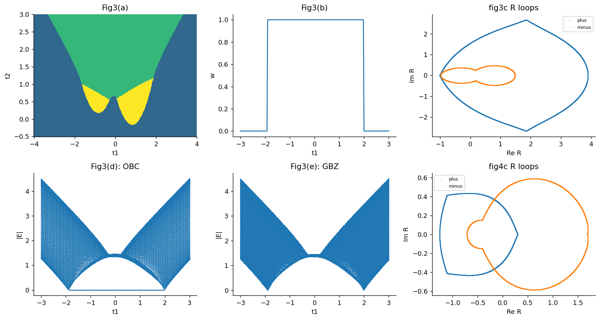

# 1902.10958: Non-Bloch Band Theory of Non-Hermitian Systems

Preprint: [arXiv:1902.10958v2 — Non-Bloch Band Theory of Non-Hermitian Systems](https://arxiv.org/abs/1902.10958v2)

Published as: [Non-Bloch Band Theory of Non-Hermitian Systems](https://doi.org/10.1103/PhysRevLett.123.066404)

Formal citation: Phys. Rev. Lett. 123, 066404 (2019) · DOI `10.1103/PhysRevLett.123.066404` · Locator `066404`

Public status: **Partial scientific reproduction** · Audit score: **Not assessed / 未评分**

广义布里渊区、非Bloch相图和体边对应得到计算支持。



## Start Here / 从这里开始

- [中文复现 Note](note/reproduction-note.zh-CN.md)
- [English reproduction note](note/reproduction-note.en.md)
- [简短图文报告 / Illustrated report](docs/report/index.html)
- [推导 / Derivation](docs/DERIVATION.md)
- [复算与范围 / Rerun and scope](docs/NUMERICAL_METHODS.md)
- [Code and run commands](code/README.md)
- [Machine-readable scorecard](outputs/checks/similarity_scorecard.json)
- [Machine-readable completion boundary](outputs/checks/completion_assessment.json)
- [Derivation (equations)](docs/DERIVATION.md)
- [Numerical methods](docs/NUMERICAL_METHODS.md)
- [Lessons learned](docs/LESSONS_LEARNED.md)

## Main Reproduced Results

| Paper item | Reproduced result | Figure | Check |
| --- | --- | --- | --- |
| Declared source targets | 广义布里渊区、非Bloch相图和体边对应得到计算支持。 | [PNG](outputs/figures/fig3-independent.png) | [JSON](outputs/checks/numerical-checks.json) |

### Declared source targets: 广义布里渊区、非Bloch相图和体边对应得到计算支持。


## Quick Run

```bash
python -m venv .venv
source .venv/bin/activate
pip install -r cases/1902.10958/code/requirements.txt
cd cases/1902.10958/code
python scripts/run_reproduction.py
```

Published machine-readable artifacts are kept under [data](outputs/data/), [figures](outputs/figures/), [checks](outputs/checks/).

## Reproduction Boundary

This public case includes paper-derived code, generated data, generated figures, public validation checks, explanatory notes. It does not redistribute the paper PDF, arXiv source archive, original figures, EPS paths, digitized source curves, source-derived point sets, or source-vs-generated composite panels.

Remaining limitation: 这仅核验带符号结果，不等于原图标签已对齐；降阶点和其余能带/环路比较仍保留。；Three complexR-loop geometry comparisons are now computed as source-only diagnostics; full original band, auxiliary-root and Lee spectrum comparisons remain.

Final-parameter rule: final public figures use the paper parameters when feasible. Any reduced-scale, subset, proxy, or blocked target must be labeled explicitly and cannot be presented as a complete reproduction.
