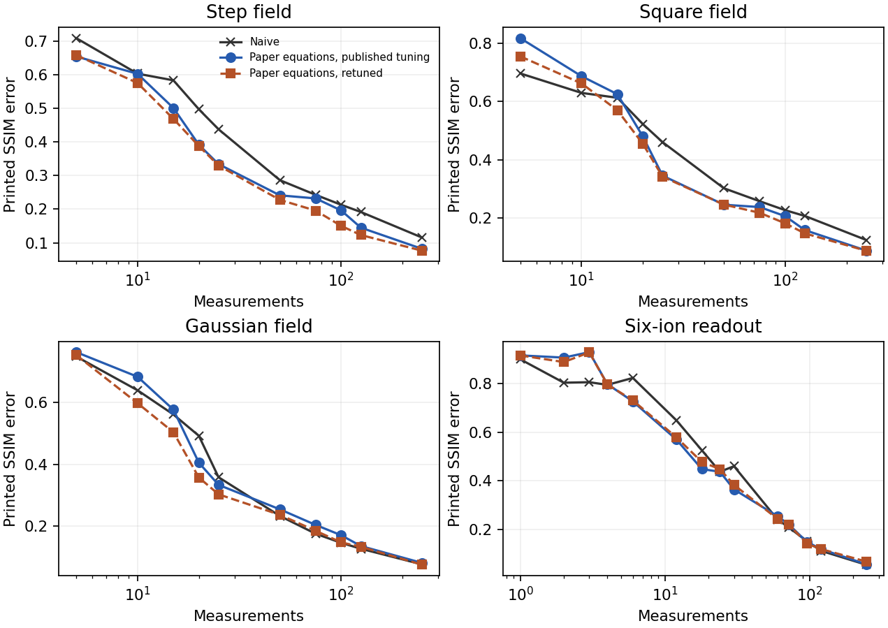

# 1904.07225: Adaptive characterization of spatially inhomogeneous fields and errors in qubit registers

Preprint: [arXiv:1904.07225v2 — Autonomous adaptive noise characterization in quantum computers](https://arxiv.org/abs/1904.07225v2)

Published as: [Adaptive characterization of spatially inhomogeneous fields and errors in qubit registers](https://doi.org/10.1038/s41534-020-0286-0)

Formal citation: npj Quantum Inf. 6, 53 (2020) · DOI `10.1038/s41534-020-0286-0` · Locator `53`

Public status: **Partial scientific reproduction** · Audit score: **Not assessed / 未评分**

独立滤波和相机帧复算恢复了局部采样优势与六离子相位梯度。



## Start Here / 从这里开始

- [中文复现 Note](note/reproduction-note.zh-CN.md)
- [English reproduction note](note/reproduction-note.en.md)
- [推导 / Derivation](docs/DERIVATION.md)
- [复算方法 / Numerical methods](docs/NUMERICAL_METHODS.md)
- [资料缺口 / Data availability](docs/DATA-AVAILABILITY.md)
- [Code and run commands](code/README.md)
- [Machine-readable scorecard](outputs/checks/similarity_scorecard.json)
- [Machine-readable completion boundary](outputs/checks/completion_assessment.json)
- [Derivation (equations)](docs/DERIVATION.md)
- [Numerical methods](docs/NUMERICAL_METHODS.md)
- [Lessons learned](docs/LESSONS_LEARNED.md)

## Main Reproduced Results

| Paper item | Reproduced result | Figure | Check |
| --- | --- | --- | --- |
| Figure 3, Figure 4 and Supplementary Figures 2–3 | 独立滤波和相机帧复算恢复了局部采样优势与六离子相位梯度。 | [PNG](outputs/figures/paper-recalculation.png) | [JSON](outputs/checks/numerical-checks.json) |

### Figure 3, Figure 4 and Supplementary Figures 2–3: 独立滤波和相机帧复算恢复了局部采样优势与六离子相位梯度。


## Quick Run

```bash
python -m venv .venv
source .venv/bin/activate
pip install -r cases/1904.07225/code/requirements.txt
cd cases/1904.07225/code
python scripts/run_reproduction.py
```

Published machine-readable artifacts are kept under [data](outputs/data/), [figures](outputs/figures/), [checks](outputs/checks/).

## Reproduction Boundary

This public case includes paper-derived code, generated data, generated figures, public validation checks, explanatory notes. It does not redistribute the paper PDF, arXiv source archive, original figures, EPS paths, digitized source curves, source-derived point sets, or source-vs-generated composite panels.

Remaining limitation: 逐档重调的最大预算比分别为方形场 1.75、六离子 1.49。原仿真轨迹、历史滤波和制图配置、原拟合森林与选帧未取得。

Final-parameter rule: final public figures use the paper parameters when feasible. Any reduced-scale, subset, proxy, or blocked target must be labeled explicitly and cannot be presented as a complete reproduction.
