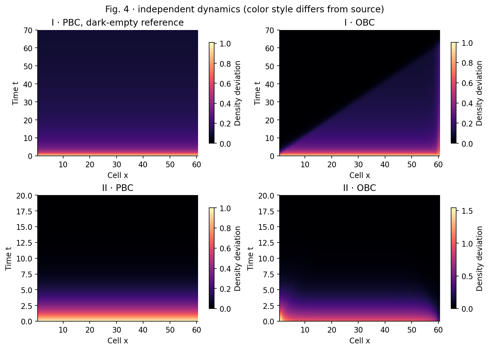
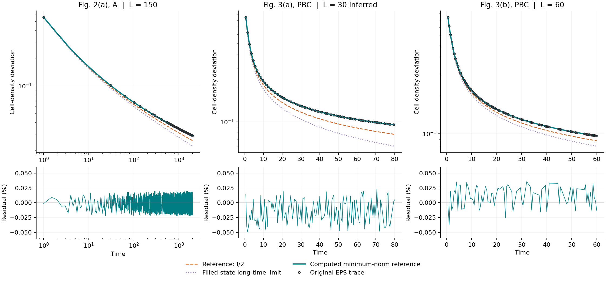

# 1904.08432: Non-Hermitian Skin Effect and Chiral Damping in Open Quantum Systems

Preprint: [arXiv:1904.08432v2 — Non-Hermitian Skin Effect and Chiral Damping in Open Quantum Systems](https://arxiv.org/abs/1904.08432v2)

Published as: [Non-Hermitian Skin Effect and Chiral Damping in Open Quantum Systems](https://doi.org/10.1103/PhysRevLett.123.170401)

Formal citation: Phys. Rev. Lett. 123, 170401 (2019) · DOI `10.1103/PhysRevLett.123.170401` · Locator `170401`

Public status: **Scientific reproduction — main physical results reproduced** · Audit score: **Not assessed / 未评分**

主要物理结果已复现：皮肤效应、边界衰减差异与手性波前；三条周期曲线对齐到原图坐标精度。



## Start Here / 从这里开始

- [中文复现 Note](note/reproduction-note.zh-CN.md)
- [English reproduction note](note/reproduction-note.en.md)
- [简短图文报告 / Illustrated report](docs/report/index.html)
- [推导与约定 / Derivation](docs/DERIVATION.md)
- [复算与证据边界 / Rerun and evidence](docs/NUMERICAL_METHODS.md)
- [稳态参考对齐 / Reference alignment](docs/alignment/index.html)
- [Code and run commands](code/README.md)
- [Machine-readable scorecard](outputs/checks/similarity_scorecard.json)
- [Machine-readable completion boundary](outputs/checks/completion_assessment.json)
- [Derivation (equations)](docs/DERIVATION.md)
- [Numerical methods](docs/NUMERICAL_METHODS.md)
- [Lessons learned](docs/LESSONS_LEARNED.md)

## Main Reproduced Results

| Paper item | Reproduced result | Figure | Check |
| --- | --- | --- | --- |
| 6 original numerical panels | 主要物理结果已复现：皮肤效应、边界衰减差异与手性波前；三条周期曲线对齐到原图坐标精度。 | [PNG](outputs/figures/F4.png) | [JSON](outputs/checks/numerical-checks.json) |

## Paper Reference vs Independent Reproduction

Minimal three-trace comparison with arXiv:1904.08432v2, Song, Yao & Wang, PRL 123, 170401 (2019), DOI 10.1103/PhysRevLett.123.170401. Open circles reproduce limited reference marks; colored lines are independent calculations. Reference content is excluded from this repository content license. Agreement at EPS graphical precision is not author-array equality.

### Periodic-reference alignment comparison



### 6 original numerical panels: 主要物理结果已复现：皮肤效应、边界衰减差异与手性波前；三条周期曲线对齐到原图坐标精度。


## Quick Run

```bash
python -m venv .venv
source .venv/bin/activate
pip install -r cases/1904.08432/code/requirements.txt
cd cases/1904.08432/code
python scripts/run_reproduction.py
```

Published machine-readable artifacts are kept under [data](outputs/data/), [figures](outputs/figures/), [checks](outputs/checks/).

## Reproduction Boundary

This public case includes paper-derived code, generated data, generated figures, public validation checks, explanatory notes, and 1 limited comparison panels. Those panels use the minimum paper excerpts needed for validation and clearly separate the paper reference from the independent result. The case does not redistribute the paper PDF, arXiv source archive, standalone original figures, EPS paths, digitized source curves, or source-derived point sets.

Remaining limitation: Finite-ring reference conventions are explicit. Fig. 3(a) periodic L=30 is inferred, not author-confirmed. Source is arXiv v2; final journal text was not compared verbatim.

Final-parameter rule: final public figures use the paper parameters when feasible. Any reduced-scale, subset, proxy, or blocked target must be labeled explicitly and cannot be presented as a complete reproduction.
