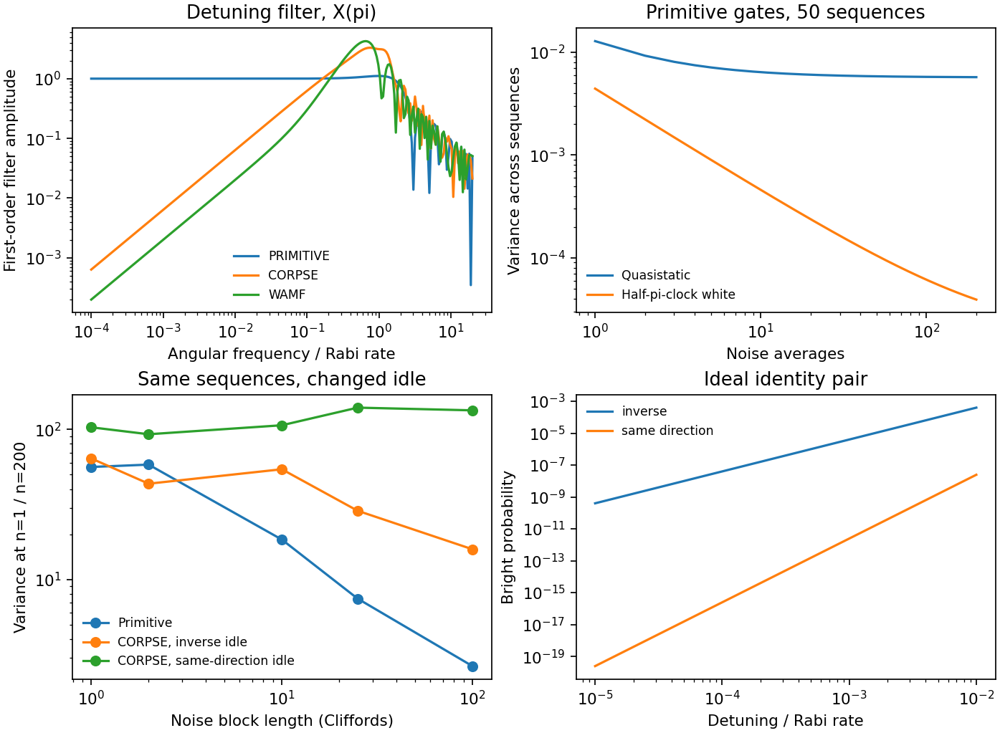

# 1909.10727: Dynamically corrected gates suppressing spatiotemporal error correlations as measured by randomized benchmarking

Preprint: [arXiv:1909.10727v1 — Dynamically corrected gates suppress spatio-temporal error correlations as measured by randomized benchmarking](https://arxiv.org/abs/1909.10727v1)

Published as: [Dynamically corrected gates suppressing spatiotemporal error correlations as measured by randomized benchmarking](https://doi.org/10.1103/PhysRevResearch.2.013156)

Formal citation: Phys. Rev. Research 2, 013156 (2020) · DOI `10.1103/PhysRevResearch.2.013156` · Locator `013156`

Public status: **Partial scientific reproduction** · Audit score: **Not assessed / 未评分**

精确传播复算噪声方差与滤波响应，并量化 CORPSE 随机基准对空闲脉冲方向的敏感性。



## Start Here / 从这里开始

- [中文复现 Note](note/reproduction-note.zh-CN.md)
- [English reproduction note](note/reproduction-note.en.md)
- [推导 / Derivation](docs/DERIVATION.md)
- [复算方法 / Numerical methods](docs/NUMERICAL_METHODS.md)
- [资料缺口 / Data availability](docs/DATA-AVAILABILITY.md)
- [Code and run commands](code/README.md)
- [Machine-readable scorecard](outputs/checks/similarity_scorecard.json)
- [Machine-readable completion boundary](outputs/checks/completion_assessment.json)
- [Derivation (equations)](docs/DERIVATION.md)
- [Numerical methods](docs/NUMERICAL_METHODS.md)
- [Lessons learned](docs/LESSONS_LEARNED.md)

## Main Reproduced Results

| Paper item | Reproduced result | Figure | Check |
| --- | --- | --- | --- |
| Figures 2–4 and Appendix C | 精确传播复算噪声方差与滤波响应，并量化 CORPSE 随机基准对空闲脉冲方向的敏感性。 | [PNG](outputs/figures/rb-recalculation.png) | [JSON](outputs/checks/numerical-checks.json) |

### Figures 2–4 and Appendix C: 精确传播复算噪声方差与滤波响应，并量化 CORPSE 随机基准对空闲脉冲方向的敏感性。


## Quick Run

```bash
python -m venv .venv
source .venv/bin/activate
pip install -r cases/1909.10727/code/requirements.txt
cd cases/1909.10727/code
python scripts/run_reproduction.py
```

Published machine-readable artifacts are kept under [data](outputs/data/), [figures](outputs/figures/), [checks](outputs/checks/).

## Reproduction Boundary

This public case includes paper-derived code, generated data, generated figures, public validation checks, explanatory notes. It does not redistribute the paper PDF, arXiv source archive, original figures, EPS paths, digitized source curves, source-derived point sets, or source-vs-generated composite panels.

Remaining limitation: 实机随机序列、AWG 波形与逐次读出未取得。实验误差幅度和五离子联合统计仍待核对。

Final-parameter rule: final public figures use the paper parameters when feasible. Any reduced-scale, subset, proxy, or blocked target must be labeled explicitly and cannot be presented as a complete reproduction.
