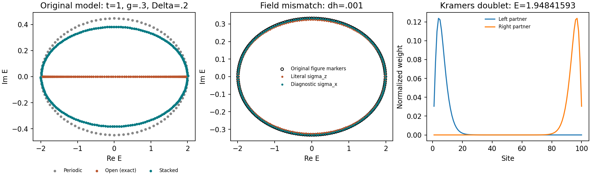

# 1910.02878: Topological theory of non-Hermitian skin effect

Preprint: [1910.02878v4 — Topological theory of non-Hermitian skin effect](https://arxiv.org/abs/1910.02878)

Formal publication: **Not recorded as of 2026-10-24**

Public status: **Partial scientific reproduction** · Audit score: **Not assessed / 未评分**

非厄米趋肤效应的多个定理、Z2 判据、边界控制和矩阵谱敏感性界得到独立核验。



## Start Here / 从这里开始

- [中文复现 Note](note/reproduction-note.zh-CN.md)
- [English reproduction note](note/reproduction-note.en.md)
- [Final same-agent report](docs/FINAL-REPORT.md)
- [Numerical methods and rerun scope](docs/NUMERICAL_METHODS.md)
- [Recorded boundaries](docs/LESSONS_LEARNED.md)
- [Code and run commands](code/README.md)
- [Machine-readable scorecard](outputs/checks/similarity_scorecard.json)
- [Machine-readable completion boundary](outputs/checks/completion_assessment.json)
- [Derivation (equations)](docs/DERIVATION.md)
- [Numerical methods](docs/NUMERICAL_METHODS.md)
- [Lessons learned](docs/LESSONS_LEARNED.md)

## Main Reproduced Results

| Paper item | Reproduced result | Figure | Check |
| --- | --- | --- | --- |
| Declared source targets | 非厄米趋肤效应的多个定理、Z2 判据、边界控制和矩阵谱敏感性界得到独立核验。 | [PNG](outputs/figures/main_check.png) | [JSON](outputs/checks/numerical-checks.json) |

### Declared source targets: 非厄米趋肤效应的多个定理、Z2 判据、边界控制和矩阵谱敏感性界得到独立核验。


## Quick Run

```bash
python -m venv .venv
source .venv/bin/activate
pip install -r cases/1910.02878/code/requirements.txt
cd cases/1910.02878/code
python scripts/run_reproduction.py
```

Published machine-readable artifacts are kept under [data](outputs/data/), [figures](outputs/figures/), [checks](outputs/checks/).

## Reproduction Boundary

This public case includes paper-derived code, generated data, generated figures, public validation checks, explanatory notes. It does not redistribute the paper PDF, arXiv source archive, original figures, EPS paths, digitized source curves, source-derived point sets, or source-vs-generated composite panels.

Remaining limitation: TII 的一般矩阵/对称类证明范围仍未决；本案例不把受限引理提升为完整物理定理。

Final-parameter rule: final public figures use the paper parameters when feasible. Any reduced-scale, subset, proxy, or blocked target must be labeled explicitly and cannot be presented as a complete reproduction.
