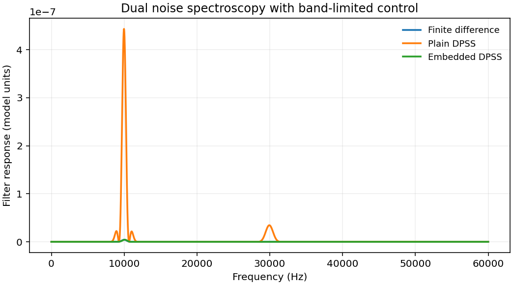

# 1911.02005: Simultaneous Spectral Estimation of Dephasing and Amplitude Noise on a Qubit Sensor via Optimally Band-Limited Control

Preprint: [arXiv:1911.02005v3 — Simultaneous spectral estimation of dephasing and amplitude noise on a qubit sensor via optimally band-limited control](https://arxiv.org/abs/1911.02005v3)

Published as: [Simultaneous Spectral Estimation of Dephasing and Amplitude Noise on a Qubit Sensor via Optimally Band-Limited Control](https://doi.org/10.1103/physrevapplied.14.024021)

Formal citation: Phys. Rev. Applied 14, 024021 (2020) · DOI `10.1103/physrevapplied.14.024021` · Locator `024021`

Public status: **Partial scientific reproduction** · Audit score: **Not assessed / 未评分**

复算有限差分滤波器、CPMG 与 DPSS。99 个共同频点和双谱图 13 组三轴读数的重分析恢复约 7 与 11 kHz 峰。两平台的 DPSS 可见标记差分别为 0.0240 和 0.0109 Hz RMS。



## Start Here / 从这里开始

- [中文复现 Note](note/reproduction-note.zh-CN.md)
- [English reproduction note](note/reproduction-note.en.md)
- [推导 / Derivation](docs/DERIVATION.md)
- [复算 / Rerun](docs/NUMERICAL_METHODS.md)
- [资料缺口 / Data availability](docs/DATA-AVAILABILITY.md)
- [Code and run commands](code/README.md)
- [Machine-readable scorecard](outputs/checks/similarity_scorecard.json)
- [Machine-readable completion boundary](outputs/checks/completion_assessment.json)
- [Derivation (equations)](docs/DERIVATION.md)
- [Numerical methods](docs/NUMERICAL_METHODS.md)
- [Lessons learned](docs/LESSONS_LEARNED.md)

## Main Reproduced Results

| Paper item | Reproduced result | Figure | Check |
| --- | --- | --- | --- |
| Finite-difference filters and simultaneous spectra | 复算有限差分滤波器、CPMG 与 DPSS。99 个共同频点和双谱图 13 组三轴读数的重分析恢复约 7 与 11 kHz 峰。两平台的 DPSS 可见标记差分别为 0.0240 和 0.0109 Hz RMS。 | [PNG](outputs/figures/overview.png) | [JSON](outputs/checks/numerical-checks.json) |

### Finite-difference filters and simultaneous spectra: 复算有限差分滤波器、CPMG 与 DPSS。99 个共同频点和双谱图 13 组三轴读数的重分析恢复约 7 与 11 kHz 峰。两平台的 DPSS 可见标记差分别为 0.0240 和 0.0109 Hz RMS。


## Quick Run

```bash
python -m venv .venv
source .venv/bin/activate
pip install -r cases/1911.02005/code/requirements.txt
cd cases/1911.02005/code
python scripts/run_reproduction.py
```

Published machine-readable artifacts are kept under [data](outputs/data/), [figures](outputs/figures/), [checks](outputs/checks/).

## Reproduction Boundary

This public case includes paper-derived code, generated data, generated figures, public validation checks, explanatory notes. It does not redistribute the paper PDF, arXiv source archive, original figures, EPS paths, digitized source curves, source-derived point sets, or source-vs-generated composite panels.

Remaining limitation: 实机读出与谱标定仍缺。主入口复算可脱离参考曲线运行的单音和脉冲滤波块。

Final-parameter rule: final public figures use the paper parameters when feasible. Any reduced-scale, subset, proxy, or blocked target must be labeled explicitly and cannot be presented as a complete reproduction.
