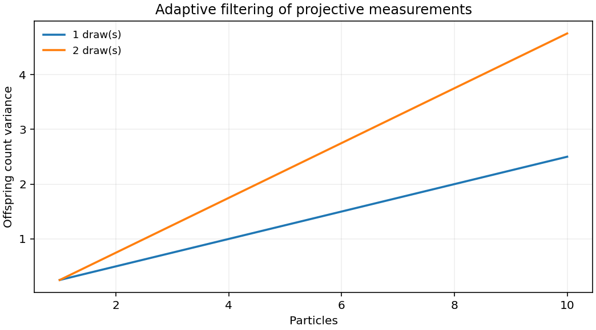

# 1911.05752: Adaptive filtering of projective quantum measurements using discrete stochastic methods

Preprint: [arXiv:1911.05752v2 — Adaptive filtering of projective quantum measurements using discrete stochastic methods](https://arxiv.org/abs/1911.05752v2)

Published as: [Adaptive filtering of projective quantum measurements using discrete stochastic methods](https://doi.org/10.1103/physreva.104.012412)

Formal citation: Phys. Rev. A 104, 012412 (2021) · DOI `10.1103/physreva.104.012412` · Locator `012412`

Public status: **Partial scientific reproduction** · Audit score: **Not assessed / 未评分**

九个面板按五档粒子数、50 次重复、75 步重算。按公开实现九组后期斜率点估计方向一致，三幅在两条区间判据下均成立。避免权重下溢后，两条截断高斯曲线方向改变。



## Start Here / 从这里开始

- [中文复现 Note](note/reproduction-note.zh-CN.md)
- [English reproduction note](note/reproduction-note.en.md)
- [推导 / Derivation](docs/DERIVATION.md)
- [复算 / Rerun](docs/NUMERICAL_METHODS.md)
- [资料缺口 / Data availability](docs/DATA-AVAILABILITY.md)
- [Code and run commands](code/README.md)
- [Machine-readable scorecard](outputs/checks/similarity_scorecard.json)
- [Machine-readable completion boundary](outputs/checks/completion_assessment.json)
- [Derivation (equations)](docs/DERIVATION.md)
- [Numerical methods](docs/NUMERICAL_METHODS.md)
- [Lessons learned](docs/LESSONS_LEARNED.md)

## Main Reproduced Results

| Paper item | Reproduced result | Figure | Check |
| --- | --- | --- | --- |
| Late-time scaling and resampling controls | 九个面板按五档粒子数、50 次重复、75 步重算。按公开实现九组后期斜率点估计方向一致，三幅在两条区间判据下均成立。避免权重下溢后，两条截断高斯曲线方向改变。 | [PNG](outputs/figures/overview.png) | [JSON](outputs/checks/numerical-checks.json) |

### Late-time scaling and resampling controls: 九个面板按五档粒子数、50 次重复、75 步重算。按公开实现九组后期斜率点估计方向一致，三幅在两条区间判据下均成立。避免权重下溢后，两条截断高斯曲线方向改变。


## Quick Run

```bash
python -m venv .venv
source .venv/bin/activate
pip install -r cases/1911.05752/code/requirements.txt
cd cases/1911.05752/code
python scripts/run_reproduction.py
```

Published machine-readable artifacts are kept under [data](outputs/data/), [figures](outputs/figures/), [checks](outputs/checks/).

## Reproduction Boundary

This public case includes paper-derived code, generated data, generated figures, public validation checks, explanatory notes. It does not redistribute the paper PDF, arXiv source archive, original figures, EPS paths, digitized source curves, source-derived point sets, or source-vs-generated composite panels.

Remaining limitation: 实际制图版本、共享关闭方式及归零规则未取得。冻结的全规模统计和公开入口的标量控制、短运行分别列出。

Final-parameter rule: final public figures use the paper parameters when feasible. Any reduced-scale, subset, proxy, or blocked target must be labeled explicitly and cannot be presented as a complete reproduction.
