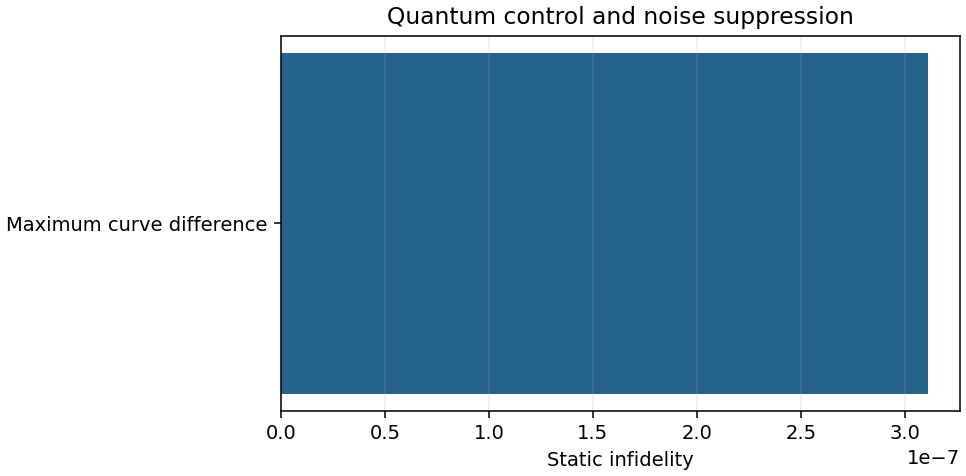

# 2001.04060: Software tools for quantum control: improving quantum computer performance through noise and error suppression

Preprint: [arXiv:2001.04060v2 — Software tools for quantum control: Improving quantum computer performance through noise and error suppression](https://arxiv.org/abs/2001.04060v2)

Published as: [Software tools for quantum control: improving quantum computer performance through noise and error suppression](https://doi.org/10.1088/2058-9565/abdca6)

Formal citation: Quantum Sci. Technol. 6, 044011 (2021) · DOI `10.1088/2058-9565/abdca6` · Locator `044011`

Public status: **Partial scientific reproduction** · Audit score: **Not assessed / 未评分**

重建 3.2 微秒 Walsh iSWAP，静态失真最大差 3.11×10⁻⁷，支持四阶标度。低频中心线保持在原图阴影带内。



## Start Here / 从这里开始

- [中文复现 Note](note/reproduction-note.zh-CN.md)
- [English reproduction note](note/reproduction-note.en.md)
- [推导 / Derivation](docs/DERIVATION.md)
- [复算 / Rerun](docs/NUMERICAL_METHODS.md)
- [资料缺口 / Data availability](docs/DATA-AVAILABILITY.md)
- [Code and run commands](code/README.md)
- [Machine-readable scorecard](outputs/checks/similarity_scorecard.json)
- [Machine-readable completion boundary](outputs/checks/completion_assessment.json)
- [Derivation (equations)](docs/DERIVATION.md)
- [Numerical methods](docs/NUMERICAL_METHODS.md)
- [Lessons learned](docs/LESSONS_LEARNED.md)

## Main Reproduced Results

| Paper item | Reproduced result | Figure | Check |
| --- | --- | --- | --- |
| Figure 11 Walsh iSWAP | 重建 3.2 微秒 Walsh iSWAP，静态失真最大差 3.11×10⁻⁷，支持四阶标度。低频中心线保持在原图阴影带内。 | [PNG](outputs/figures/overview.png) | [JSON](outputs/checks/numerical-checks.json) |

### Figure 11 Walsh iSWAP: 重建 3.2 微秒 Walsh iSWAP，静态失真最大差 3.11×10⁻⁷，支持四阶标度。低频中心线保持在原图阴影带内。


## Quick Run

```bash
python -m venv .venv
source .venv/bin/activate
pip install -r cases/2001.04060/code/requirements.txt
cd cases/2001.04060/code
python scripts/run_reproduction.py
```

Published machine-readable artifacts are kept under [data](outputs/data/), [figures](outputs/figures/), [checks](outputs/checks/).

## Reproduction Boundary

This public case includes paper-derived code, generated data, generated figures, public validation checks, explanatory notes. It does not redistribute the paper PDF, arXiv source archive, original figures, EPS paths, digitized source curves, source-derived point sets, or source-vs-generated composite panels.

Remaining limitation: 缺原多 GPU 计时、实测控制，以及个别原出图波形设置。公开默认运行核对 Walsh 模型。

Final-parameter rule: final public figures use the paper parameters when feasible. Any reduced-scale, subset, proxy, or blocked target must be labeled explicitly and cannot be presented as a complete reproduction.
