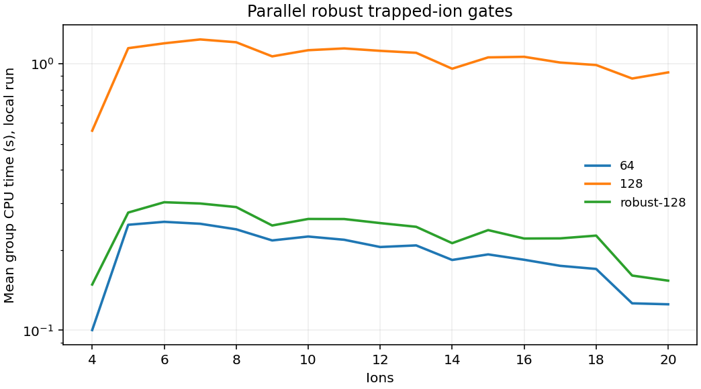

# 2005.00366: Numeric Optimization for Configurable, Parallel, Error‐Robust Entangling Gates in Large Ion Registers

Preprint: [arXiv:2005.00366v1 — Numeric optimization for configurable, parallel, error-robust entangling gates in large ion registers](https://arxiv.org/abs/2005.00366v1)

Published as: [Numeric Optimization for Configurable, Parallel, Error‐Robust Entangling Gates in Large Ion Registers](https://doi.org/10.1002/qute.202000044)

Formal citation: Adv. Quantum Technol. 3, 2000044 (2020) · DOI `10.1002/qute.202000044` · Locator `2000044`

Public status: **Partial scientific reproduction** · Audit score: **Not assessed / 未评分**

名义五离子条件下，严格闭合且一阶鲁棒的字面 +π/4 不可达，−3π/4 给出全局相位等价门。严格 PM 网格判别了 2,173 个单元。独立结果覆盖 4–20 离子链和 20 离子并行门。



## Start Here / 从这里开始

- [中文复现 Note](note/reproduction-note.zh-CN.md)
- [English reproduction note](note/reproduction-note.en.md)
- [推导 / Derivation](docs/DERIVATION.md)
- [复算 / Rerun](docs/NUMERICAL_METHODS.md)
- [资料缺口 / Data availability](docs/DATA-AVAILABILITY.md)
- [Code and run commands](code/README.md)
- [Machine-readable scorecard](outputs/checks/similarity_scorecard.json)
- [Machine-readable completion boundary](outputs/checks/completion_assessment.json)
- [Derivation (equations)](docs/DERIVATION.md)
- [Numerical methods](docs/NUMERICAL_METHODS.md)
- [Lessons learned](docs/LESSONS_LEARNED.md)

## Main Reproduced Results

| Paper item | Reproduced result | Figure | Check |
| --- | --- | --- | --- |
| Figure 4, Figures 5–6 and Appendix B | 名义五离子条件下，严格闭合且一阶鲁棒的字面 +π/4 不可达，−3π/4 给出全局相位等价门。严格 PM 网格判别了 2,173 个单元。独立结果覆盖 4–20 离子链和 20 离子并行门。 | [PNG](outputs/figures/overview.png) | [JSON](outputs/checks/numerical-checks.json) |

### Figure 4, Figures 5–6 and Appendix B: 名义五离子条件下，严格闭合且一阶鲁棒的字面 +π/4 不可达，−3π/4 给出全局相位等价门。严格 PM 网格判别了 2,173 个单元。独立结果覆盖 4–20 离子链和 20 离子并行门。


## Quick Run

```bash
python -m venv .venv
source .venv/bin/activate
pip install -r cases/2005.00366/code/requirements.txt
cd cases/2005.00366/code
python scripts/run_reproduction.py
```

Published machine-readable artifacts are kept under [data](outputs/data/), [figures](outputs/figures/), [checks](outputs/checks/).

## Reproduction Boundary

This public case includes paper-derived code, generated data, generated figures, public validation checks, explanatory notes. It does not redistribute the paper PDF, arXiv source archive, original figures, EPS paths, digitized source curves, source-derived point sets, or source-vs-generated composite panels.

Remaining limitation: 精确原脉冲、优化初值、噪声及计时记录未取得。名义链长标度和同硬件运行时间分别看待。

Final-parameter rule: final public figures use the paper parameters when feasible. Any reduced-scale, subset, proxy, or blocked target must be labeled explicitly and cannot be presented as a complete reproduction.
