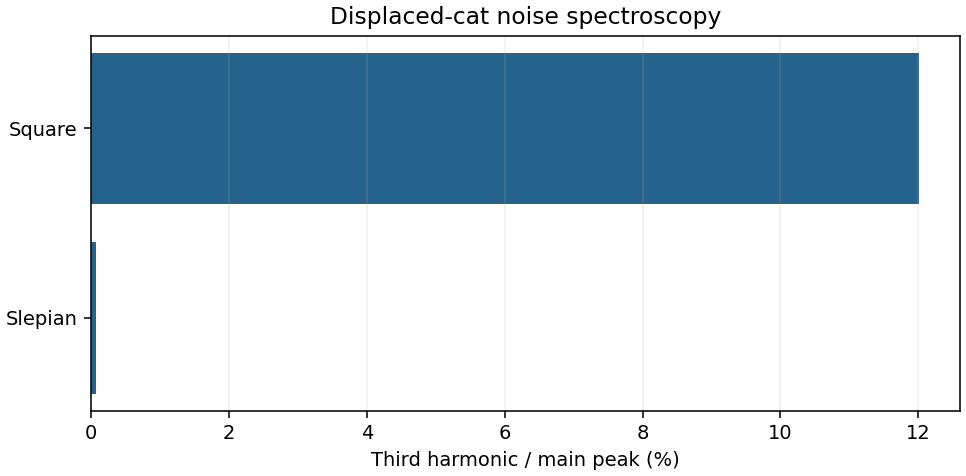

# 2010.04375: Quantum Oscillator Noise Spectroscopy via Displaced Cat States

Preprint: [arXiv:2010.04375v2 — Quantum oscillator noise spectroscopy via displaced cat states](https://arxiv.org/abs/2010.04375v2)

Published as: [Quantum Oscillator Noise Spectroscopy via Displaced Cat States](https://doi.org/10.1103/physrevlett.126.250506)

Formal citation: Phys. Rev. Lett. 126, 250506 (2021) · DOI `10.1103/physrevlett.126.250506` · Locator `250506`

Public status: **Partial scientific reproduction** · Audit score: **Not assessed / 未评分**

独立复算猫态相位翻转滤波和非负谱反演。2 ms、7 次翻转时，方波第三谐波对主峰功率比为 12.01%，Slepian 包络为 0.0646%。



## Start Here / 从这里开始

- [中文复现 Note](note/reproduction-note.zh-CN.md)
- [English reproduction note](note/reproduction-note.en.md)
- [推导 / Derivation](docs/DERIVATION.md)
- [复算 / Rerun](docs/NUMERICAL_METHODS.md)
- [资料缺口 / Data availability](docs/DATA-AVAILABILITY.md)
- [Code and run commands](code/README.md)
- [Machine-readable scorecard](outputs/checks/similarity_scorecard.json)
- [Machine-readable completion boundary](outputs/checks/completion_assessment.json)
- [Derivation (equations)](docs/DERIVATION.md)
- [Numerical methods](docs/NUMERICAL_METHODS.md)
- [Lessons learned](docs/LESSONS_LEARNED.md)

## Main Reproduced Results

| Paper item | Reproduced result | Figure | Check |
| --- | --- | --- | --- |
| Filter response and spectrum inversion | 独立复算猫态相位翻转滤波和非负谱反演。2 ms、7 次翻转时，方波第三谐波对主峰功率比为 12.01%，Slepian 包络为 0.0646%。 | [PNG](outputs/figures/overview.png) | [JSON](outputs/checks/numerical-checks.json) |

### Filter response and spectrum inversion: 独立复算猫态相位翻转滤波和非负谱反演。2 ms、7 次翻转时，方波第三谐波对主峰功率比为 12.01%，Slepian 包络为 0.0646%。


## Quick Run

```bash
python -m venv .venv
source .venv/bin/activate
pip install -r cases/2010.04375/code/requirements.txt
cd cases/2010.04375/code
python scripts/run_reproduction.py
```

Published machine-readable artifacts are kept under [data](outputs/data/), [figures](outputs/figures/), [checks](outputs/checks/).

## Reproduction Boundary

This public case includes paper-derived code, generated data, generated figures, public validation checks, explanatory notes. It does not redistribute the paper PDF, arXiv source archive, original figures, EPS paths, digitized source curves, source-derived point sets, or source-vs-generated composite panels.

Remaining limitation: 公开均值支持约 5.25 kHz 和 31.3–31.5 kHz 峰，原 AOM 相位指令和逐次测量待核。

Final-parameter rule: final public figures use the paper parameters when feasible. Any reduced-scale, subset, proxy, or blocked target must be labeled explicitly and cannot be presented as a complete reproduction.
