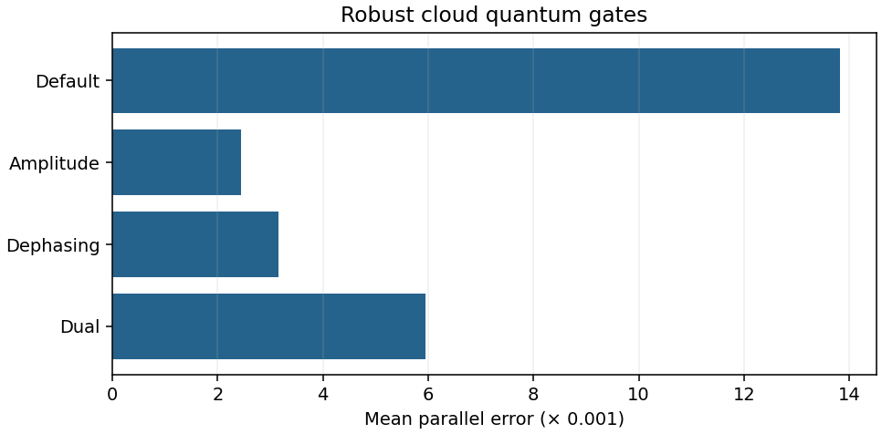

# 2010.08057: Error-Robust Quantum Logic Optimization Using a Cloud Quantum Computer Interface

Preprint: [arXiv:2010.08057v1 — Error-robust quantum logic optimization using a cloud quantum computer interface](https://arxiv.org/abs/2010.08057v1)

Published as: [Error-Robust Quantum Logic Optimization Using a Cloud Quantum Computer Interface](https://doi.org/10.1103/physrevapplied.15.064054)

Formal citation: Phys. Rev. Applied 15, 064054 (2021) · DOI `10.1103/physrevapplied.15.064054` · Locator `064054`

Public status: **Partial scientific reproduction** · Audit score: **Not assessed / 未评分**

按同一执行方式聚合公开五比特误差。并行的三种鲁棒门均值为 2.447、3.157、5.953×10⁻³，默认门为 13.829×10⁻³。



## Start Here / 从这里开始

- [中文复现 Note](note/reproduction-note.zh-CN.md)
- [English reproduction note](note/reproduction-note.en.md)
- [推导 / Derivation](docs/DERIVATION.md)
- [复算 / Rerun](docs/NUMERICAL_METHODS.md)
- [资料缺口 / Data availability](docs/DATA-AVAILABILITY.md)
- [Code and run commands](code/README.md)
- [Machine-readable scorecard](outputs/checks/similarity_scorecard.json)
- [Machine-readable completion boundary](outputs/checks/completion_assessment.json)
- [Derivation (equations)](docs/DERIVATION.md)
- [Numerical methods](docs/NUMERICAL_METHODS.md)
- [Lessons learned](docs/LESSONS_LEARNED.md)

## Main Reproduced Results

| Paper item | Reproduced result | Figure | Check |
| --- | --- | --- | --- |
| Appendix C and filter response | 按同一执行方式聚合公开五比特误差。并行的三种鲁棒门均值为 2.447、3.157、5.953×10⁻³，默认门为 13.829×10⁻³。 | [PNG](outputs/figures/overview.png) | [JSON](outputs/checks/numerical-checks.json) |

### Appendix C and filter response: 按同一执行方式聚合公开五比特误差。并行的三种鲁棒门均值为 2.447、3.157、5.953×10⁻³，默认门为 13.829×10⁻³。


## Quick Run

```bash
python -m venv .venv
source .venv/bin/activate
pip install -r cases/2010.08057/code/requirements.txt
cd cases/2010.08057/code
python scripts/run_reproduction.py
```

Published machine-readable artifacts are kept under [data](outputs/data/), [figures](outputs/figures/), [checks](outputs/checks/).

## Reproduction Boundary

This public case includes paper-derived code, generated data, generated figures, public validation checks, explanatory notes. It does not redistribute the paper PDF, arXiv source archive, original figures, EPS paths, digitized source curves, source-derived point sets, or source-vs-generated composite panels.

Remaining limitation: 缺原硬件测量序列和读出。公开入口独立核对脉冲响应。

Final-parameter rule: final public figures use the paper parameters when feasible. Any reduced-scale, subset, proxy, or blocked target must be labeled explicitly and cannot be presented as a complete reproduction.
