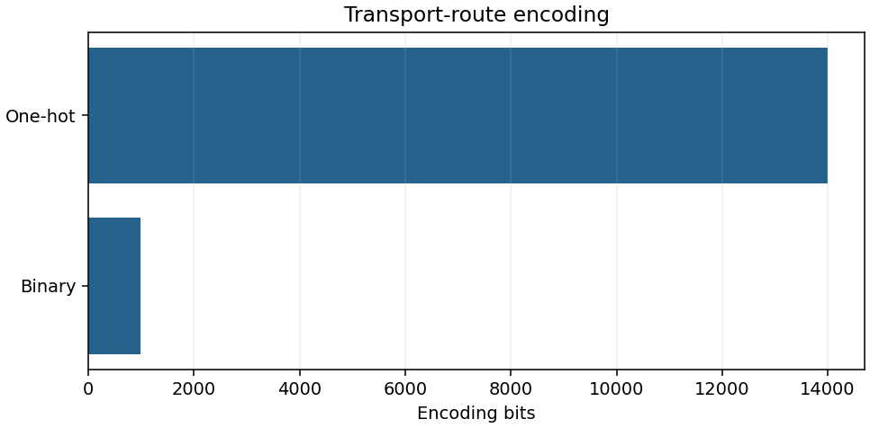

# 2206.07313: Quantum computing for transport optimization

Preprint: [arXiv:2206.07313v1 — Quantum computing for transport optimization](https://arxiv.org/abs/2206.07313v1)

Formal publication: **Not recorded as of 2026-11-15**

Public status: **Partial scientific reproduction** · Audit score: **Not assessed / 未评分**

100 位乘客、7 辆车的固定容量例复得 14,000 个独热位和 980 个二进制位。四客户模型的 24 个可行排列与经典成本一致。



## Start Here / 从这里开始

- [中文复现 Note](note/reproduction-note.zh-CN.md)
- [English reproduction note](note/reproduction-note.en.md)
- [推导 / Derivation](docs/DERIVATION.md)
- [复算 / Rerun](docs/NUMERICAL_METHODS.md)
- [资料缺口 / Data availability](docs/DATA-AVAILABILITY.md)
- [Code and run commands](code/README.md)
- [Machine-readable scorecard](outputs/checks/similarity_scorecard.json)
- [Machine-readable completion boundary](outputs/checks/completion_assessment.json)
- [Derivation (equations)](docs/DERIVATION.md)
- [Numerical methods](docs/NUMERICAL_METHODS.md)
- [Lessons learned](docs/LESSONS_LEARNED.md)

## Main Reproduced Results

| Paper item | Reproduced result | Figure | Check |
| --- | --- | --- | --- |
| Figures 2–4 encoding and decoding | 100 位乘客、7 辆车的固定容量例复得 14,000 个独热位和 980 个二进制位。四客户模型的 24 个可行排列与经典成本一致。 | [PNG](outputs/figures/overview.png) | [JSON](outputs/checks/numerical-checks.json) |

### Figures 2–4 encoding and decoding: 100 位乘客、7 辆车的固定容量例复得 14,000 个独热位和 980 个二进制位。四客户模型的 24 个可行排列与经典成本一致。


## Quick Run

```bash
python -m venv .venv
source .venv/bin/activate
pip install -r cases/2206.07313/code/requirements.txt
cd cases/2206.07313/code
python scripts/run_reproduction.py
```

Published machine-readable artifacts are kept under [data](outputs/data/), [figures](outputs/figures/), [checks](outputs/checks/).

## Reproduction Boundary

This public case includes paper-derived code, generated data, generated figures, public validation checks, explanatory notes. It does not redistribute the paper PDF, arXiv source archive, original figures, EPS paths, digitized source curves, source-derived point sets, or source-vs-generated composite panels.

Remaining limitation: 缺 Lagos 计数、硬件编译和原解码。变量节省属于固定容量示例。

Final-parameter rule: final public figures use the paper parameters when feasible. Any reduced-scale, subset, proxy, or blocked target must be labeled explicitly and cannot be presented as a complete reproduction.
