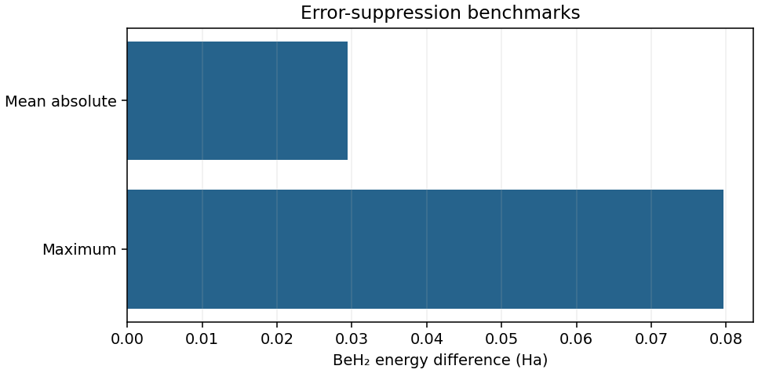

# 2209.06864: Experimental Benchmarking of an Automated Deterministic Error-Suppression Workflow for Quantum Algorithms

Preprint: [arXiv:2209.06864v2 — Experimental benchmarking of an automated deterministic error suppression workflow for quantum algorithms](https://arxiv.org/abs/2209.06864v2)

Published as: [Experimental Benchmarking of an Automated Deterministic Error-Suppression Workflow for Quantum Algorithms](https://doi.org/10.1103/physrevapplied.20.024034)

Formal citation: Phys. Rev. Applied 20, 024034 (2023) · DOI `10.1103/physrevapplied.20.024034` · Locator `024034`

Public status: **Partial scientific reproduction** · Audit score: **Not assessed / 未评分**

独立基线覆盖 BV、QFT、Grover、QEC 综合征与量子体积。补算 25 个 BeH₂ 键长，源图复读的平均能量误差改善约 4.92 倍。



## Start Here / 从这里开始

- [中文复现 Note](note/reproduction-note.zh-CN.md)
- [English reproduction note](note/reproduction-note.en.md)
- [推导 / Derivation](docs/DERIVATION.md)
- [复算 / Rerun](docs/NUMERICAL_METHODS.md)
- [资料缺口 / Data availability](docs/DATA-AVAILABILITY.md)
- [Code and run commands](code/README.md)
- [Machine-readable scorecard](outputs/checks/similarity_scorecard.json)
- [Machine-readable completion boundary](outputs/checks/completion_assessment.json)
- [Derivation (equations)](docs/DERIVATION.md)
- [Numerical methods](docs/NUMERICAL_METHODS.md)
- [Lessons learned](docs/LESSONS_LEARNED.md)

## Main Reproduced Results

| Paper item | Reproduced result | Figure | Check |
| --- | --- | --- | --- |
| Circuit controls and Figure 7(a) BeH₂ | 独立基线覆盖 BV、QFT、Grover、QEC 综合征与量子体积。补算 25 个 BeH₂ 键长，源图复读的平均能量误差改善约 4.92 倍。 | [PNG](outputs/figures/overview.png) | [JSON](outputs/checks/numerical-checks.json) |

### Circuit controls and Figure 7(a) BeH₂: 独立基线覆盖 BV、QFT、Grover、QEC 综合征与量子体积。补算 25 个 BeH₂ 键长，源图复读的平均能量误差改善约 4.92 倍。


## Quick Run

```bash
python -m venv .venv
source .venv/bin/activate
pip install -r cases/2209.06864/code/requirements.txt
cd cases/2209.06864/code
python scripts/run_reproduction.py
```

Published machine-readable artifacts are kept under [data](outputs/data/), [figures](outputs/figures/), [checks](outputs/checks/).

## Reproduction Boundary

This public case includes paper-derived code, generated data, generated figures, public validation checks, explanatory notes. It does not redistribute the paper PDF, arXiv source archive, original figures, EPS paths, digitized source curves, source-derived point sets, or source-vs-generated composite panels.

Remaining limitation: 缺原逐点变分角、部分分子模型约定和实机记录。可选 BeH₂ 复算使用 PySCF。

Final-parameter rule: final public figures use the paper parameters when feasible. Any reduced-scale, subset, proxy, or blocked target must be labeled explicitly and cannot be presented as a complete reproduction.
