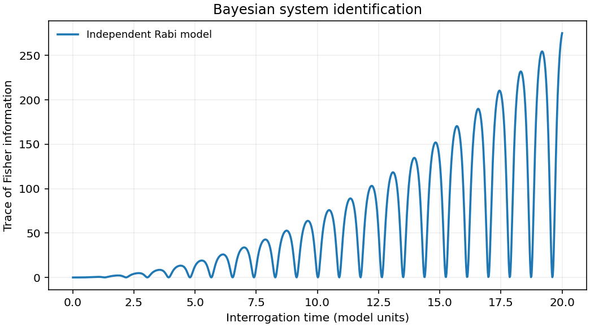

# 2211.09090: Optimized Bayesian system identification in quantum devices

Preprint: [arXiv:2211.09090v1 — Optimised Bayesian system identification in quantum devices](https://arxiv.org/abs/2211.09090v1)

Published as: [Optimized Bayesian system identification in quantum devices](https://doi.org/10.1103/physrevapplied.21.014012)

Formal citation: Phys. Rev. Applied 21, 014012 (2024) · DOI `10.1103/physrevapplied.21.014012` · Locator `014012`

Public status: **Partial scientific reproduction** · Audit score: **Not assessed / 未评分**

复算 9 张图的 32 个数值面板。离子阱头两次返回概率为 0.743 和 0.544，落在论文所报误差内，93 倍口径重算为 92.73 倍。独立闭环控制比较了单比特、双比特和相位设计。



## Start Here / 从这里开始

- [中文复现 Note](note/reproduction-note.zh-CN.md)
- [English reproduction note](note/reproduction-note.en.md)
- [推导 / Derivation](docs/DERIVATION.md)
- [复算 / Rerun](docs/NUMERICAL_METHODS.md)
- [资料缺口 / Data availability](docs/DATA-AVAILABILITY.md)
- [Code and run commands](code/README.md)
- [Machine-readable scorecard](outputs/checks/similarity_scorecard.json)
- [Machine-readable completion boundary](outputs/checks/completion_assessment.json)
- [Derivation (equations)](docs/DERIVATION.md)
- [Numerical methods](docs/NUMERICAL_METHODS.md)
- [Lessons learned](docs/LESSONS_LEARNED.md)

## Main Reproduced Results

| Paper item | Reproduced result | Figure | Check |
| --- | --- | --- | --- |
| Adaptive experiment design and closed-loop diagnostics | 复算 9 张图的 32 个数值面板。离子阱头两次返回概率为 0.743 和 0.544，落在论文所报误差内，93 倍口径重算为 92.73 倍。独立闭环控制比较了单比特、双比特和相位设计。 | [PNG](outputs/figures/overview.png) | [JSON](outputs/checks/numerical-checks.json) |

### Adaptive experiment design and closed-loop diagnostics: 复算 9 张图的 32 个数值面板。离子阱头两次返回概率为 0.743 和 0.544，落在论文所报误差内，93 倍口径重算为 92.73 倍。独立闭环控制比较了单比特、双比特和相位设计。


## Quick Run

```bash
python -m venv .venv
source .venv/bin/activate
pip install -r cases/2211.09090/code/requirements.txt
cd cases/2211.09090/code
python scripts/run_reproduction.py
```

Published machine-readable artifacts are kept under [data](outputs/data/), [figures](outputs/figures/), [checks](outputs/checks/).

## Reproduction Boundary

This public case includes paper-derived code, generated data, generated figures, public validation checks, explanatory notes. It does not redistribute the paper PDF, arXiv source archive, original figures, EPS paths, digitized source curves, source-derived point sets, or source-vs-generated composite panels.

Remaining limitation: 原闭环参数和逐次离子读出缺失。高斯似然分母的因子差异需和闭环模型约定一并解读。

Final-parameter rule: final public figures use the paper parameters when feasible. Any reduced-scale, subset, proxy, or blocked target must be labeled explicitly and cannot be presented as a complete reproduction.
