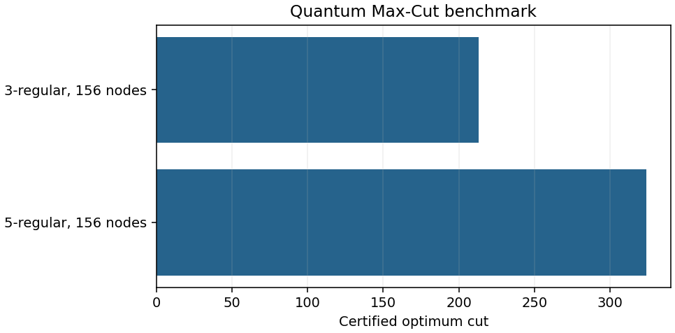

# 2406.01743: Integrated error-suppressed pipeline for quantum optimization of nontrivial binary combinatorial optimization problems on gate-model hardware at the 156-qubit scale

Preprint: [arXiv:2406.01743v5 — Integrated error-suppressed pipeline for quantum optimization of nontrivial binary combinatorial optimization problems on gate-model hardware at the 156-qubit scale](https://arxiv.org/abs/2406.01743v5)

Published as: [Integrated error-suppressed pipeline for quantum optimization of nontrivial binary combinatorial optimization problems on gate-model hardware at the 156-qubit scale](https://doi.org/10.1088/1367-2630/ae7150)

Formal citation: New J. Phys. 28, 064506 (2026) · DOI `10.1088/1367-2630/ae7150` · Locator `064506`

Public status: **Partial scientific reproduction** · Audit score: **Not assessed / 未评分**

独立证明两张 156 节点原种子无权图的最优割为 213、324。80 节点加权图的表 II 为 2.08%，附图 9(f) 读得 3.060%–3.087%。



## Start Here / 从这里开始

- [中文复现 Note](note/reproduction-note.zh-CN.md)
- [English reproduction note](note/reproduction-note.en.md)
- [推导 / Derivation](docs/DERIVATION.md)
- [复算 / Rerun](docs/NUMERICAL_METHODS.md)
- [资料缺口 / Data availability](docs/DATA-AVAILABILITY.md)
- [Code and run commands](code/README.md)
- [Machine-readable scorecard](outputs/checks/similarity_scorecard.json)
- [Machine-readable completion boundary](outputs/checks/completion_assessment.json)
- [Derivation (equations)](docs/DERIVATION.md)
- [Numerical methods](docs/NUMERICAL_METHODS.md)
- [Lessons learned](docs/LESSONS_LEARNED.md)

## Main Reproduced Results

| Paper item | Reproduced result | Figure | Check |
| --- | --- | --- | --- |
| Unweighted certificates and weighted Figure 9(f) | 独立证明两张 156 节点原种子无权图的最优割为 213、324。80 节点加权图的表 II 为 2.08%，附图 9(f) 读得 3.060%–3.087%。 | [PNG](outputs/figures/overview.png) | [JSON](outputs/checks/numerical-checks.json) |

### Unweighted certificates and weighted Figure 9(f): 独立证明两张 156 节点原种子无权图的最优割为 213、324。80 节点加权图的表 II 为 2.08%，附图 9(f) 读得 3.060%–3.087%。


## Quick Run

```bash
python -m venv .venv
source .venv/bin/activate
pip install -r cases/2406.01743/code/requirements.txt
cd cases/2406.01743/code
python scripts/run_reproduction.py
```

Published machine-readable artifacts are kept under [data](outputs/data/), [figures](outputs/figures/), [checks](outputs/checks/).

## Reproduction Boundary

This public case includes paper-derived code, generated data, generated figures, public validation checks, explanatory notes. It does not redistribute the paper PDF, arXiv source archive, original figures, EPS paths, digitized source curves, source-derived point sets, or source-vs-generated composite panels.

Remaining limitation: 加权边表与实机样本仍缺，当前只能定位 80 节点图表口径差异。

Final-parameter rule: final public figures use the paper parameters when feasible. Any reduced-scale, subset, proxy, or blocked target must be labeled explicitly and cannot be presented as a complete reproduction.
