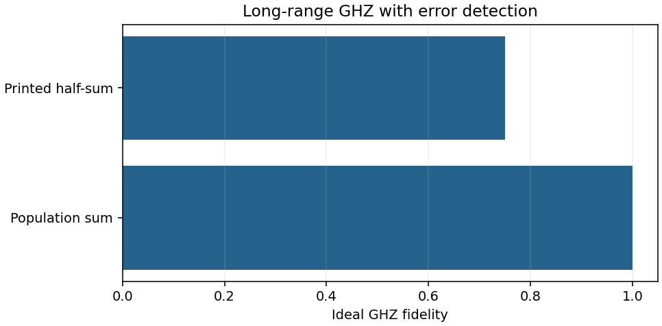

# 2411.14638: Achieving Computational Gains with Quantum Error-Correction Primitives: Generation of Long-Range Entanglement Enhanced by Error Detection

Preprint: [arXiv:2411.14638v2 — Achieving computational gains with quantum error-correction primitives: Generation of long-range entanglement enhanced by error detection](https://arxiv.org/abs/2411.14638v2)

Published as: [Achieving Computational Gains with Quantum Error-Correction Primitives: Generation of Long-Range Entanglement Enhanced by Error Detection](https://doi.org/10.1103/prxquantum.6.020331)

Formal citation: PRX Quantum 6, 020331 (2025) · DOI `10.1103/prxquantum.6.020331` · Locator `020331`

Public status: **Partial scientific reproduction** · Audit score: **Not assessed / 未评分**

核对远程 CNOT 的测量分支和 GHZ 旗标条件。理想 GHZ 代入原印刷半和得 0.75，改用两端布居总和可恢复 1。



## Start Here / 从这里开始

- [中文复现 Note](note/reproduction-note.zh-CN.md)
- [English reproduction note](note/reproduction-note.en.md)
- [推导 / Derivation](docs/DERIVATION.md)
- [复算 / Rerun](docs/NUMERICAL_METHODS.md)
- [资料缺口 / Data availability](docs/DATA-AVAILABILITY.md)
- [Code and run commands](code/README.md)
- [Machine-readable scorecard](outputs/checks/similarity_scorecard.json)
- [Machine-readable completion boundary](outputs/checks/completion_assessment.json)
- [Derivation (equations)](docs/DERIVATION.md)
- [Numerical methods](docs/NUMERICAL_METHODS.md)
- [Lessons learned](docs/LESSONS_LEARNED.md)

## Main Reproduced Results

| Paper item | Reproduced result | Figure | Check |
| --- | --- | --- | --- |
| Remote CNOT and GHZ flagging | 核对远程 CNOT 的测量分支和 GHZ 旗标条件。理想 GHZ 代入原印刷半和得 0.75，改用两端布居总和可恢复 1。 | [PNG](outputs/figures/overview.png) | [JSON](outputs/checks/numerical-checks.json) |

### Remote CNOT and GHZ flagging: 核对远程 CNOT 的测量分支和 GHZ 旗标条件。理想 GHZ 代入原印刷半和得 0.75，改用两端布居总和可恢复 1。


## Quick Run

```bash
python -m venv .venv
source .venv/bin/activate
pip install -r cases/2411.14638/code/requirements.txt
cd cases/2411.14638/code
python scripts/run_reproduction.py
```

Published machine-readable artifacts are kept under [data](outputs/data/), [figures](outputs/figures/), [checks](outputs/checks/).

## Reproduction Boundary

This public case includes paper-derived code, generated data, generated figures, public validation checks, explanatory notes. It does not redistribute the paper PDF, arXiv source archive, original figures, EPS paths, digitized source curves, source-derived point sets, or source-vs-generated composite panels.

Remaining limitation: 缺 75 比特联合计数和历史处理记录。模型噪声率与实机后选择比例分开。

Final-parameter rule: final public figures use the paper parameters when feasible. Any reduced-scale, subset, proxy, or blocked target must be labeled explicitly and cannot be presented as a complete reproduction.
