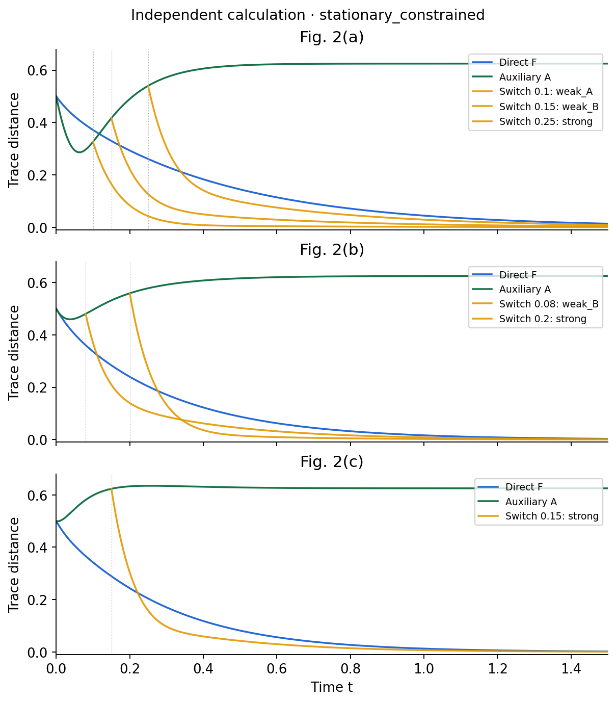

# 2505.14622: Pontus-Mpemba Effects

Preprint: [arXiv:2505.14622v2 — Pontus-Mpemba Effects](https://arxiv.org/abs/2505.14622v2)

Published as: [Pontus-Mpemba Effects](https://doi.org/10.1103/hhgj-89gj)

Formal citation: Phys. Rev. Lett. 135, 140404 (2025) · DOI `10.1103/hhgj-89gj` · Locator `140404`

Public status: **Scientific reproduction — main physical results reproduced** · Audit score: **Not assessed / 未评分**

主要物理结果已复现：三类加速与计入制备时间的优势；0.14% 的短时浅谷不改变主要加速结论。



## Start Here / 从这里开始

- [中文复现 Note](note/reproduction-note.zh-CN.md)
- [English reproduction note](note/reproduction-note.en.md)
- [简短图文报告 / Illustrated report](docs/report/index.html)
- [推导与约定 / Derivation](docs/DERIVATION.md)
- [复算与证据边界 / Rerun and evidence](docs/NUMERICAL_METHODS.md)
- [Code and run commands](code/README.md)
- [Machine-readable scorecard](outputs/checks/similarity_scorecard.json)
- [Machine-readable completion boundary](outputs/checks/completion_assessment.json)
- [Derivation (equations)](docs/DERIVATION.md)
- [Numerical methods](docs/NUMERICAL_METHODS.md)
- [Lessons learned](docs/LESSONS_LEARNED.md)

## Main Reproduced Results

| Paper item | Reproduced result | Figure | Check |
| --- | --- | --- | --- |
| 8 original numerical panels | 主要物理结果已复现：三类加速与计入制备时间的优势；0.14% 的短时浅谷不改变主要加速结论。 | [PNG](outputs/figures/F2-stationary_constrained.png) | [JSON](outputs/checks/numerical-checks.json) |

### 8 original numerical panels: 主要物理结果已复现：三类加速与计入制备时间的优势；0.14% 的短时浅谷不改变主要加速结论。


## Quick Run

```bash
python -m venv .venv
source .venv/bin/activate
pip install -r cases/2505.14622/code/requirements.txt
cd cases/2505.14622/code
python scripts/run_reproduction.py
```

Published machine-readable artifacts are kept under [data](outputs/data/), [figures](outputs/figures/), [checks](outputs/checks/).

## Reproduction Boundary

This public case includes paper-derived code, generated data, generated figures, public validation checks, explanatory notes. It does not redistribute the paper PDF, arXiv source archive, original figures, EPS paths, digitized source curves, source-derived point sets, or source-vs-generated composite panels.

Remaining limitation: Both printed and steady-state-constrained parameter versions are retained. A 0.14% initial dip is resolved; the public notebook output grid skips it. Main acceleration results remain supported.

Final-parameter rule: final public figures use the paper parameters when feasible. Any reduced-scale, subset, proxy, or blocked target must be labeled explicitly and cannot be presented as a complete reproduction.
