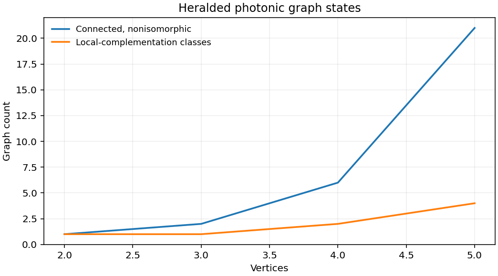

# 2508.16505: Automated discovery of heralded ballistic graph state generators for fusion-based photonic quantum computation

Preprint: [arXiv:2508.16505v2 — Automated discovery of heralded ballistic graph state generators for fusion-based photonic quantum computation](https://arxiv.org/abs/2508.16505v2)

Published as: [Automated discovery of heralded ballistic graph state generators for fusion-based photonic quantum computation](https://doi.org/10.1103/c4v4-wz65)

Formal citation: Phys. Rev. A 113, 042608 (2026) · DOI `10.1103/c4v4-wz65` · Locator `042608`

Public status: **Partial scientific reproduction** · Audit score: **Not assessed / 未评分**

用傅里叶系数、稀疏产生算符和矩阵积和独立核对有限光子数传播。论文的五模四光子 Bell 例子给出成功率 1/9 和单位保真度。另枚举小图类别并核对编译恒等式。



## Start Here / 从这里开始

- [中文复现 Note](note/reproduction-note.zh-CN.md)
- [English reproduction note](note/reproduction-note.en.md)
- [推导 / Derivation](docs/DERIVATION.md)
- [复算 / Rerun](docs/NUMERICAL_METHODS.md)
- [资料缺口 / Data availability](docs/DATA-AVAILABILITY.md)
- [Code and run commands](code/README.md)
- [Machine-readable scorecard](outputs/checks/similarity_scorecard.json)
- [Machine-readable completion boundary](outputs/checks/completion_assessment.json)
- [Derivation (equations)](docs/DERIVATION.md)
- [Numerical methods](docs/NUMERICAL_METHODS.md)
- [Lessons learned](docs/LESSONS_LEARNED.md)

## Main Reproduced Results

| Paper item | Reproduced result | Figure | Check |
| --- | --- | --- | --- |
| Five-mode Bell example and graph-class controls | 用傅里叶系数、稀疏产生算符和矩阵积和独立核对有限光子数传播。论文的五模四光子 Bell 例子给出成功率 1/9 和单位保真度。另枚举小图类别并核对编译恒等式。 | [PNG](outputs/figures/overview.png) | [JSON](outputs/checks/numerical-checks.json) |

### Five-mode Bell example and graph-class controls: 用傅里叶系数、稀疏产生算符和矩阵积和独立核对有限光子数传播。论文的五模四光子 Bell 例子给出成功率 1/9 和单位保真度。另枚举小图类别并核对编译恒等式。


## Quick Run

```bash
python -m venv .venv
source .venv/bin/activate
pip install -r cases/2508.16505/code/requirements.txt
cd cases/2508.16505/code
python scripts/run_reproduction.py
```

Published machine-readable artifacts are kept under [data](outputs/data/), [figures](outputs/figures/), [checks](outputs/checks/).

## Reproduction Boundary

This public case includes paper-derived code, generated data, generated figures, public validation checks, explanatory notes. It does not redistribute the paper PDF, arXiv source archive, original figures, EPS paths, digitized source curves, source-derived point sets, or source-vs-generated composite panels.

Remaining limitation: 原规模的独立电路搜索、稀疏化和计时仍未完成。公开矩阵的验证属于条件检查，当前原生记录没有正式逐对象评定。

Final-parameter rule: final public figures use the paper parameters when feasible. Any reduced-scale, subset, proxy, or blocked target must be labeled explicitly and cannot be presented as a complete reproduction.
