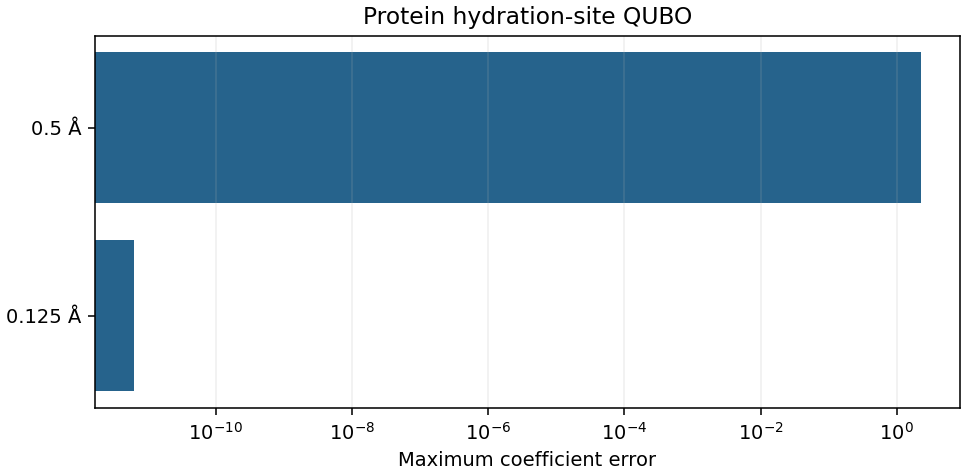

# 2512.08390: Practical protein-pocket hydration-site prediction for drug discovery on a quantum computer

Preprint: [arXiv:2512.08390v2 — Practical protein-pocket hydration-site prediction for drug discovery on a quantum computer](https://arxiv.org/abs/2512.08390v2)

Published as: [Practical protein-pocket hydration-site prediction for drug discovery on a quantum computer](https://doi.org/10.1103/gyqr-mv1h)

Formal citation: Phys. Rev. Research 8, 033344 (2026) · DOI `10.1103/gyqr-mv1h` · Locator `033344`

Public status: **Partial scientific reproduction** · Audit score: **Not assessed / 未评分**

从高斯重叠推导 QUBO，在 4 和 15 变量实例上穷举并核对 Ising 映射。积分步长从 0.5 Å 缩至 0.125 Å 后，窄密度系数误差由 2.25 降至 6.37×10⁻¹²。



## Start Here / 从这里开始

- [中文复现 Note](note/reproduction-note.zh-CN.md)
- [English reproduction note](note/reproduction-note.en.md)
- [推导 / Derivation](docs/DERIVATION.md)
- [复算 / Rerun](docs/NUMERICAL_METHODS.md)
- [资料缺口 / Data availability](docs/DATA-AVAILABILITY.md)
- [Code and run commands](code/README.md)
- [Machine-readable scorecard](outputs/checks/similarity_scorecard.json)
- [Machine-readable completion boundary](outputs/checks/completion_assessment.json)
- [Derivation (equations)](docs/DERIVATION.md)
- [Numerical methods](docs/NUMERICAL_METHODS.md)
- [Lessons learned](docs/LESSONS_LEARNED.md)

## Main Reproduced Results

| Paper item | Reproduced result | Figure | Check |
| --- | --- | --- | --- |
| Hydration cost and scoring rules | 从高斯重叠推导 QUBO，在 4 和 15 变量实例上穷举并核对 Ising 映射。积分步长从 0.5 Å 缩至 0.125 Å 后，窄密度系数误差由 2.25 降至 6.37×10⁻¹²。 | [PNG](outputs/figures/overview.png) | [JSON](outputs/checks/numerical-checks.json) |

### Hydration cost and scoring rules: 从高斯重叠推导 QUBO，在 4 和 15 变量实例上穷举并核对 Ising 映射。积分步长从 0.5 Å 缩至 0.125 Å 后，窄密度系数误差由 2.25 降至 6.37×10⁻¹²。


## Quick Run

```bash
python -m venv .venv
source .venv/bin/activate
pip install -r cases/2512.08390/code/requirements.txt
cd cases/2512.08390/code
python scripts/run_reproduction.py
```

Published machine-readable artifacts are kept under [data](outputs/data/), [figures](outputs/figures/), [checks](outputs/checks/).

## Reproduction Boundary

This public case includes paper-derived code, generated data, generated figures, public validation checks, explanatory notes. It does not redistribute the paper PDF, arXiv source archive, original figures, EPS paths, digitized source curves, source-derived point sets, or source-vs-generated composite panels.

Remaining limitation: 缺原溶剂体素、预测水位点和量子试验记录。公开运行覆盖成本模型及条件核查。

Final-parameter rule: final public figures use the paper parameters when feasible. Any reduced-scale, subset, proxy, or blocked target must be labeled explicitly and cannot be presented as a complete reproduction.
