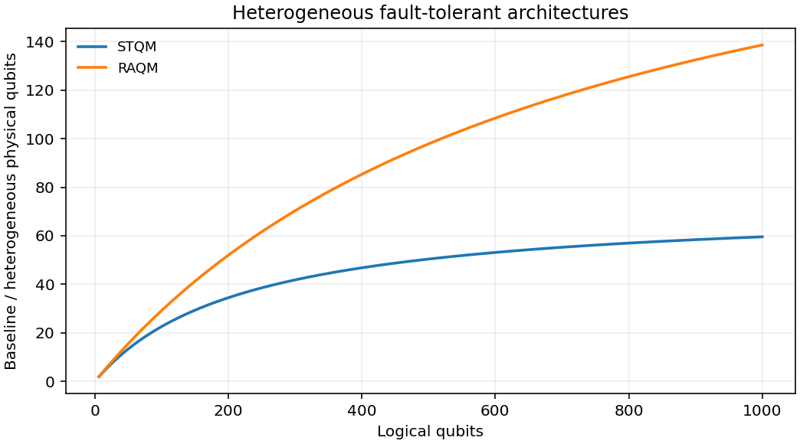

# 2604.06319: Heterogeneous architectures enable a 138× reduction in physical qubit requirements for fault-tolerant quantum computing under detailed accounting

Preprint: [arXiv:2604.06319v2 — Heterogeneous architectures enable a 138x reduction in physical qubit requirements for fault-tolerant quantum computing under detailed accounting](https://arxiv.org/abs/2604.06319v2)

Published as: [Heterogeneous architectures enable a 138× reduction in physical qubit requirements for fault-tolerant quantum computing under detailed accounting](https://doi.org/10.1088/1367-2630/aeb71b)

Formal citation: New J. Phys. 28, 114501 (2026) · DOI `10.1088/1367-2630/aeb71b` · Locator `114501`

Public status: **Partial scientific reproduction** · Audit score: **Not assessed / 未评分**

按发表版附录重建 QPU、量子存储和链路账本。1000 逻辑比特时，基准相对 STQM 和 RAQM 的物理比特比分别为 59.56 和 138.58。RSA 的两组关键配置重算为约 38.1 万和 19.0 万物理比特。



## Start Here / 从这里开始

- [中文复现 Note](note/reproduction-note.zh-CN.md)
- [English reproduction note](note/reproduction-note.en.md)
- [推导 / Derivation](docs/DERIVATION.md)
- [复算 / Rerun](docs/NUMERICAL_METHODS.md)
- [资料缺口 / Data availability](docs/DATA-AVAILABILITY.md)
- [Code and run commands](code/README.md)
- [Machine-readable scorecard](outputs/checks/similarity_scorecard.json)
- [Machine-readable completion boundary](outputs/checks/completion_assessment.json)
- [Derivation (equations)](docs/DERIVATION.md)
- [Numerical methods](docs/NUMERICAL_METHODS.md)
- [Lessons learned](docs/LESSONS_LEARNED.md)

## Main Reproduced Results

| Paper item | Reproduced result | Figure | Check |
| --- | --- | --- | --- |
| Figures 4–6 and resource tables | 按发表版附录重建 QPU、量子存储和链路账本。1000 逻辑比特时，基准相对 STQM 和 RAQM 的物理比特比分别为 59.56 和 138.58。RSA 的两组关键配置重算为约 38.1 万和 19.0 万物理比特。 | [PNG](outputs/figures/overview.png) | [JSON](outputs/checks/numerical-checks.json) |

### Figures 4–6 and resource tables: 按发表版附录重建 QPU、量子存储和链路账本。1000 逻辑比特时，基准相对 STQM 和 RAQM 的物理比特比分别为 59.56 和 138.58。RSA 的两组关键配置重算为约 38.1 万和 19.0 万物理比特。


## Quick Run

```bash
python -m venv .venv
source .venv/bin/activate
pip install -r cases/2604.06319/code/requirements.txt
cd cases/2604.06319/code
python scripts/run_reproduction.py
```

Published machine-readable artifacts are kept under [data](outputs/data/), [figures](outputs/figures/), [checks](outputs/checks/).

## Reproduction Boundary

This public case includes paper-derived code, generated data, generated figures, public validation checks, explanatory notes. It does not redistribute the paper PDF, arXiv source archive, original figures, EPS paths, digitized source curves, source-derived point sets, or source-vs-generated composite panels.

Remaining limitation: 原始编译电路、逐门调度及噪声记录缺失。表 6 周期标签和非局部耦合器权重仍有差异。

Final-parameter rule: final public figures use the paper parameters when feasible. Any reduced-scale, subset, proxy, or blocked target must be labeled explicitly and cannot be presented as a complete reproduction.
