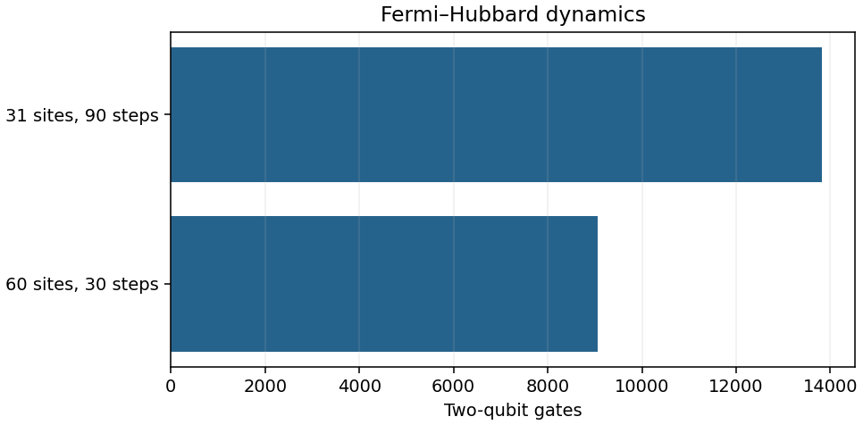

# 2605.04025: Fast, accurate, high-resolution simulation of large-scale Fermi-Hubbard models on a digital quantum processor

Preprint: [arXiv:2605.04025v2 — Fast, accurate, high-resolution simulation of large-scale Fermi-Hubbard models on a digital quantum processor](https://arxiv.org/abs/2605.04025v2)

Formal publication: **Not recorded as of 2026-11-15**

Public status: **Partial scientific reproduction** · Audit score: **Not assessed / 未评分**

独立复算镜像线路、费米扇区和截断张量网络。31 格 90 步为 452 层、13,829 个双比特门，60 格 30 步为 152 层、9,057 个。



## Start Here / 从这里开始

- [中文复现 Note](note/reproduction-note.zh-CN.md)
- [English reproduction note](note/reproduction-note.en.md)
- [推导 / Derivation](docs/DERIVATION.md)
- [复算 / Rerun](docs/NUMERICAL_METHODS.md)
- [资料缺口 / Data availability](docs/DATA-AVAILABILITY.md)
- [Code and run commands](code/README.md)
- [Machine-readable scorecard](outputs/checks/similarity_scorecard.json)
- [Machine-readable completion boundary](outputs/checks/completion_assessment.json)
- [Derivation (equations)](docs/DERIVATION.md)
- [Numerical methods](docs/NUMERICAL_METHODS.md)
- [Lessons learned](docs/LESSONS_LEARNED.md)

## Main Reproduced Results

| Paper item | Reproduced result | Figure | Check |
| --- | --- | --- | --- |
| Mirrored product formula and Table S1 | 独立复算镜像线路、费米扇区和截断张量网络。31 格 90 步为 452 层、13,829 个双比特门，60 格 30 步为 152 层、9,057 个。 | [PNG](outputs/figures/overview.png) | [JSON](outputs/checks/numerical-checks.json) |

### Mirrored product formula and Table S1: 独立复算镜像线路、费米扇区和截断张量网络。31 格 90 步为 452 层、13,829 个双比特门，60 格 30 步为 152 层、9,057 个。


## Quick Run

```bash
python -m venv .venv
source .venv/bin/activate
pip install -r cases/2605.04025/code/requirements.txt
cd cases/2605.04025/code
python scripts/run_reproduction.py
```

Published machine-readable artifacts are kept under [data](outputs/data/), [figures](outputs/figures/), [checks](outputs/checks/).

## Reproduction Boundary

This public case includes paper-derived code, generated data, generated figures, public validation checks, explanatory notes. It does not redistribute the paper PDF, arXiv source archive, original figures, EPS paths, digitized source curves, source-derived point sets, or source-vs-generated composite panels.

Remaining limitation: 图 S9 的格点和自旋标注仍有歧义，原实机 shots、高键维 TDVP 和多 GPU 计时待核。

Final-parameter rule: final public figures use the paper parameters when feasible. Any reduced-scale, subset, proxy, or blocked target must be labeled explicitly and cannot be presented as a complete reproduction.
