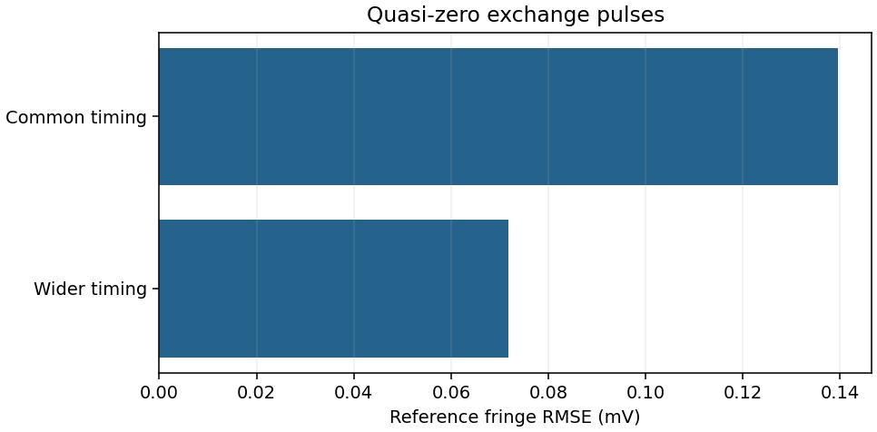

# 2606.07472: Driving Exchange Interaction in Spin Qubits with Quasi-Zero Pulses

Preprint: [arXiv:2606.07472v1 — Driving Exchange Interaction in Spin Qubits with Quasi-Zero Pulses](https://arxiv.org/abs/2606.07472v1)

Formal publication: **Not recorded as of 2026-11-15**

Public status: **Partial scientific reproduction** · Audit score: **Not assessed / 未评分**

重建四极点电压传递与指数交换。锁定共享时序时，三组 25 点的参考条纹误差为 0.1395 mV，放宽时序后为 0.0718 mV。



## Start Here / 从这里开始

- [中文复现 Note](note/reproduction-note.zh-CN.md)
- [English reproduction note](note/reproduction-note.en.md)
- [推导 / Derivation](docs/DERIVATION.md)
- [复算 / Rerun](docs/NUMERICAL_METHODS.md)
- [资料缺口 / Data availability](docs/DATA-AVAILABILITY.md)
- [Code and run commands](code/README.md)
- [Machine-readable scorecard](outputs/checks/similarity_scorecard.json)
- [Machine-readable completion boundary](outputs/checks/completion_assessment.json)
- [Derivation (equations)](docs/DERIVATION.md)
- [Numerical methods](docs/NUMERICAL_METHODS.md)
- [Lessons learned](docs/LESSONS_LEARNED.md)

## Main Reproduced Results

| Paper item | Reproduced result | Figure | Check |
| --- | --- | --- | --- |
| Figure 3 pulse and fringe model | 重建四极点电压传递与指数交换。锁定共享时序时，三组 25 点的参考条纹误差为 0.1395 mV，放宽时序后为 0.0718 mV。 | [PNG](outputs/figures/overview.png) | [JSON](outputs/checks/numerical-checks.json) |

### Figure 3 pulse and fringe model: 重建四极点电压传递与指数交换。锁定共享时序时，三组 25 点的参考条纹误差为 0.1395 mV，放宽时序后为 0.0718 mV。


## Quick Run

```bash
python -m venv .venv
source .venv/bin/activate
pip install -r cases/2606.07472/code/requirements.txt
cd cases/2606.07472/code
python scripts/run_reproduction.py
```

Published machine-readable artifacts are kept under [data](outputs/data/), [figures](outputs/figures/), [checks](outputs/checks/).

## Reproduction Boundary

This public case includes paper-derived code, generated data, generated figures, public validation checks, explanatory notes. It does not redistribute the paper PDF, arXiv source archive, original figures, EPS paths, digitized source curves, source-derived point sets, or source-vs-generated composite panels.

Remaining limitation: 原脉冲时序和 Tunnel Falls 标定仍缺。拟合对时序约束敏感，公开入口复算独立脉冲模型。

Final-parameter rule: final public figures use the paper parameters when feasible. Any reduced-scale, subset, proxy, or blocked target must be labeled explicitly and cannot be presented as a complete reproduction.
