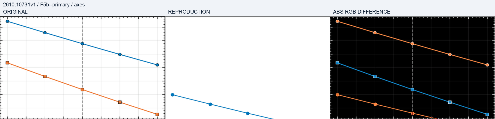

# 原图、复现图与差异的阅读方法

最新比较是[制备译码接受率](comparisons/preparation-acceptance.png)。它使用 Fig. 5(b) 的参考读数及独立生成数据，解释几百分点的残余差距。

## 历史固定坐标像素对照

三联图依次为原文摘录、历史独立计算、差分。该图来自 `pixel-comparison-v1`，早于本文的 preparation-decoder v2；它不能证明或否定最新 MAP 曲线。原坐标范围固定为 640×400 的注册框，不移动曲线寻找最佳重合。字体、刻度、线宽、颜色和布局可贡献像素误差；轴内曲线偏离需结合数值残差解释。当曲线落到原纵轴范围之外时，缺少前景不意味着吻合。

这里不把旧 RGB MAE 转移到新图，也不把白色背景相似当作科学通过。最新接受率对应[这份生成数据](../outputs/data/preparation/results.json)与[聚合误差](../outputs/checks/preparation-summary.json)。

## 来源与许可

必要源摘录及读点来自 Menon et al., [arXiv:2610.10731v1](https://arxiv.org/abs/2610.10731v1), Fig. 5(b)。比较板中的源内容保留原作者权利，不适用本仓库的开放内容许可。没有发布独立原图、原始论文或数字化参考曲线。视觉相似与作者数据层面的等同分别判断。
