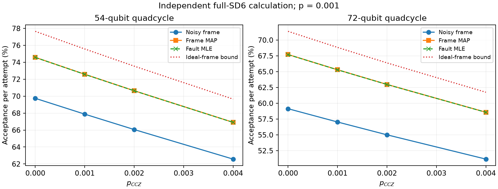
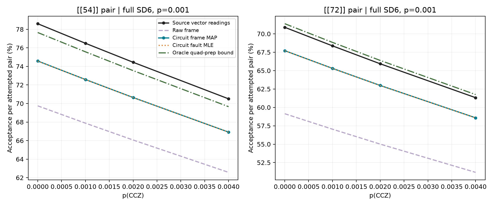

# qLDPC magic-state factories: locating the acceptance gap

**The code algebra is independently checkable. Circuit-level preparation decoding substantially improves acceptance under the declared full-noise circuit, but the paper's absolute acceptance, complete conditional logical error rate and resource advantage remain unresolved.** This partial reproduction concerns Menon et al., [arXiv:2610.10731v1](https://arxiv.org/abs/2610.10731v1), with evidence dated 13 October 2026.

[中文报告](reproduction-note.zh-CN.md) · [Code](../code/README.md) · [Evidence map](../docs/EVIDENCE_INDEX.md) · [Quantification](../docs/QUANTIFICATION.md)

## Scientific question

High-rate qLDPC blocks need a practical non-Clifford resource. The proposed factory prepares magic states in tricycle codes, transfers them through an escape operation into larger-distance quadcycle codes, and rejects detectable faults. Its performance depends jointly on acceptance, error probability conditional on acceptance, and cost per useful output. Verifying the stabilizer matrices alone cannot establish a factory resource advantage.

This is a theoretical and numerical reproduction. We did not operate a neutral-atom experiment, and unavailable laboratory equipment is not used to excuse unfinished classical calculations.

## Model to computation

Finite-group polynomials are expanded into binary permutation matrices. The exact GF(2) checks are

$$H_XH_Z^T=0,\qquad M_XH_X=M_ZH_Z=0,\qquad
k=n-\operatorname{rank}H_X-\operatorname{rank}H_Z.$$

All five Table II constructions pass the commutation and metacheck identities. Their tricycle and quadcycle logical dimensions are 3 and 6. The two small tricycle codes have exact $(d_X,d_Z)=(6,3),(8,4)$. For the larger three, only the $d_X$ upper bounds 15, 19 and 28 are established; their $d_Z$ values are exactly 5, 6 and 7. Quadcycle distances are exactly 6 and 8 for 54 and 72 qubits; explicit logical operators give upper bounds 14, 17 and 21 for 162, 228 and 420 qubits. The final bound improves the paper's heuristic estimate of 25, without refuting an exact-distance theorem. Larger-code minimum distances remain unknown. See the [derivation](../docs/DERIVATION.md) and [distance witnesses](../outputs/data/extra-distances.json).

The SD6 calculation retains one-qubit/idle depolarization, two-qubit depolarization, preparation and measurement flips, each at its stated rate $p$. The CCZ one-pair marginal uses $16p_{\rm CCZ}/21$ under the uniform-nonidentity convention. The resulting Clifford phase diagnostic is not complete magic-state infidelity.

Every attempt enters the acceptance denominator. Final quad readout does not enter postselection. For operational metacheck record $S$, hidden preparation frame $F$ and detector word $D$,

$$A=\{D\oplus\widehat F(S)=0\},\qquad
\alpha=P(A),\qquad p_L=P(L\ne0\mid A).$$

Frame MAP sums probabilities of fault explanations within the same frame class. Fault MLE selects a most likely independent DEM fault configuration. They are not interchangeable. Ideal labels used to construct a probability model are never supplied to the operational decoder. Generation reads only model/configuration inputs, not figure readings.

## Main result

At $p=0.001$, $p_{\rm CCZ}=0.002$, with the fixed default order and declared `fresh_aligned` timing:

| Acceptance per attempt | 54-qubit code | 72-qubit code |
|---|---:|---:|
| Approximate figure reading | 74.4453% | 65.9287% |
| Noisy frame | 66.0619% | 55.0104% |
| Frame MAP | 70.6444% | 62.9821% |
| Fault MLE | 70.6362% | 62.9706% |
| Ideal quad preparation-frame information | 73.5470% | 66.3845% |



The figure above uses the [generated distributions](../outputs/data/preparation/results.json). The comparison below includes reference readings from Fig. 5(b); they are not author-supplied numerical arrays.



Reference content is attributed to the linked arXiv v1 and excluded from the repository content license. Agreement in this comparison does not establish author-data-level equivalence.

The remaining MAP gaps are approximately **3.8009 and 2.9466 percentage points**. Across eight reference points the RMSE is **3.4349 percentage points**, with maximum discrepancy **4.0216 points**. The experiment comprises 44 configurations, 96 original tricycle order controls and four million gate-level samples. These measure computational work, not whole-paper completion.

Even perfect knowledge of the quad preparation frame leaves the 54-qubit circuit about 0.8983 percentage points below the reference. Under this fixed remaining circuit and information set, changing only that decoder is insufficient. A joint decoder using additional accessible records or another valid postselection circuit is not ruled out.

## Reliability and interpretation

Acceptance is evaluated by finite-distribution summation in float64: there is no Monte Carlo sampling uncertainty in that calculation, but no interval-arithmetic certificate either. Character transforms, normalization, noise factorization, gate-level sampling and separate small-model enumeration provide cross-checks.

An additional 160 tricycle schedules per code were examined. Each code had 32 candidates with the best proved phase-probe distance in that family, 3 and 4 respectively; their MAP acceptances and ideal-frame bounds agreed. Lower-distance orders were not chosen to fit the reference. This is a finite-family investigation, not globally optimal scheduling or a complete three-block factory fault-distance result.

The [historical registered pixel comparison](../docs/COMPARISONS.md) separates axis/layout residue from numerical differences. It predates the preparation-decoder correction and does not measure the latest MAP curve.

## Scope and remaining work

Complete conditional logical-error counting, rare-event statistics for larger codes, the $10^{-9}$ target and the claimed 10–40-fold resource advantage remain unfinished. No certified failures in a bounded low-order fault subset does not imply zero logical error. The ancillary animation also has a code-coordinate/gate-table consistency issue under its literal combined implementation; that separate source-implementation audit does not refute the abstract factory and is not counted as an acceptance result here.

Our remaining calculations and source information that could resolve ambiguities are listed separately in [boundaries](../docs/BOUNDARIES.md). Missing author code is not treated as an external blocker while relevant independent checks remain feasible. No author email was sent.

## Rerun

Install this case's `code/requirements.txt`, then run from the repository root:

```bash
python cases/2610.10731/code/scripts/run_reproduction.py --mode quick
python cases/2610.10731/code/scripts/run_reproduction.py --mode preparation
```

The quick mode recomputes five algebra constructions and one original-parameter acceptance control. The preparation mode replays the 44-configuration experiment; its historical wall time was about 24.5 minutes, hardware dependent. Outputs go to a new temporary directory. `--mode verify` reanalyzes frozen arrays and `--mode render` redraws the published generated figure. Neither packaging checks nor a quick run certify the whole paper. See [numerical methods](../docs/NUMERICAL_METHODS.md).
