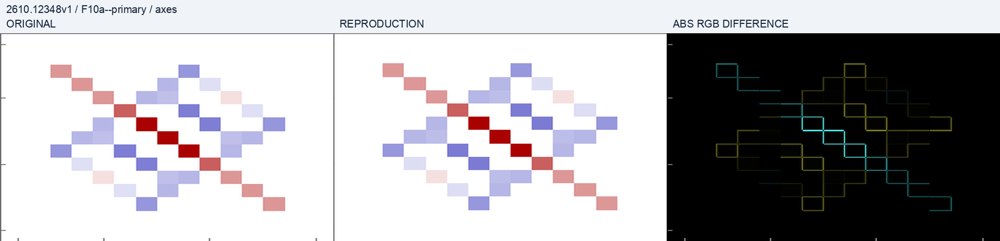
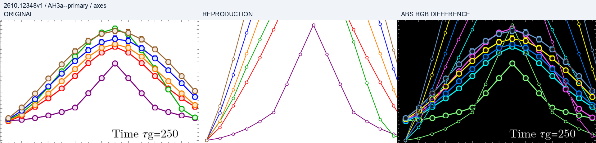

# 原图、复现图与差异的阅读方法

最新 H3 比较见[归一化诊断](comparisons/h3-normalization.png)，H2 的统计比较见[CDF](comparisons/h2-cdf.png)。源图读数不是作者原始数组，也不是作者置信区间。

## 静态面板的历史注册比较

## H3 的历史注册比较

三联图依次为参考摘录、独立计算和差分。固定坐标框为 640×400，没有为降低误差而移动科学曲线。它们是 `pixel-comparison-v1` 的历史结果：H3 还没有采用本报告 v2 新样本诊断。原版 F10a 的轴外残差主要反映排版；H3 的轴内峰高差则需要物理定义和数值检查解释，不能一起归为字体问题。

最新 raw 比较改进的是一个明确的候选诊断量；原物理熵仍保留。旧像素分数没有被当作新版数据或新版绘图的分数。完整归一化解释以[聚合残差](../outputs/checks/h3-summary.json)、[逐轨迹数组](../outputs/data/h3/samples.npz)及明确公式为依据。

## 来源与许可

必要参考摘录与读点来自 Halati, Jin and Moessner, [arXiv:2610.12348v1](https://arxiv.org/abs/2610.12348v1), Figs. 10(a), H2 and H3。源内容保留原作者权利，不适用本仓库开放内容许可。独立生成内容与参考内容分列；未发布独立原图、完整论文或源点数据集。图形接近不证明作者实现身份。
