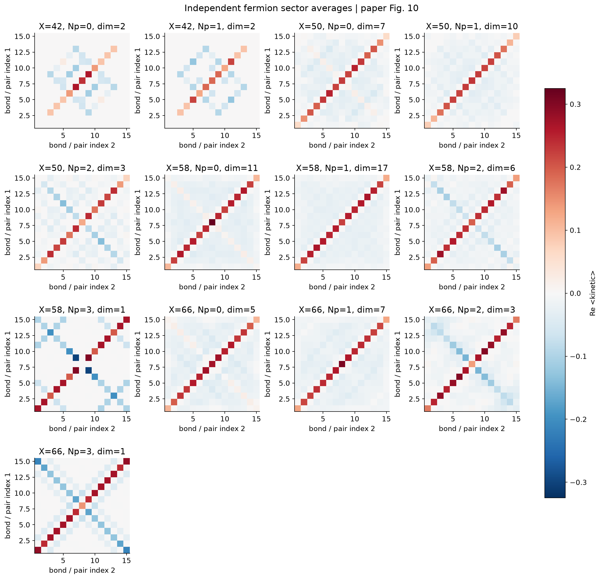
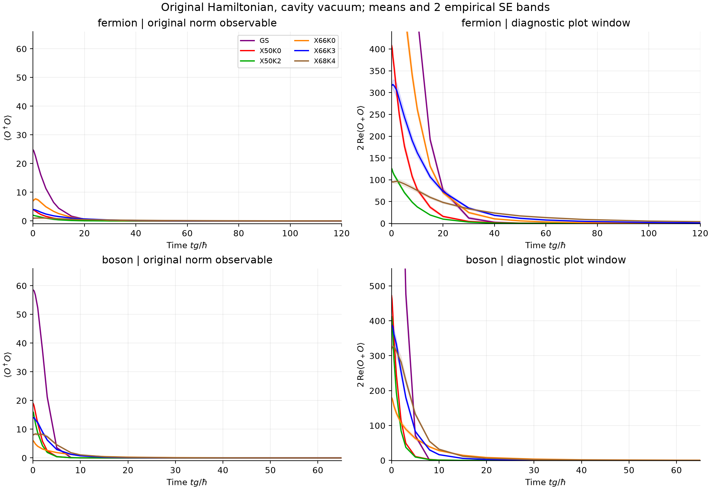
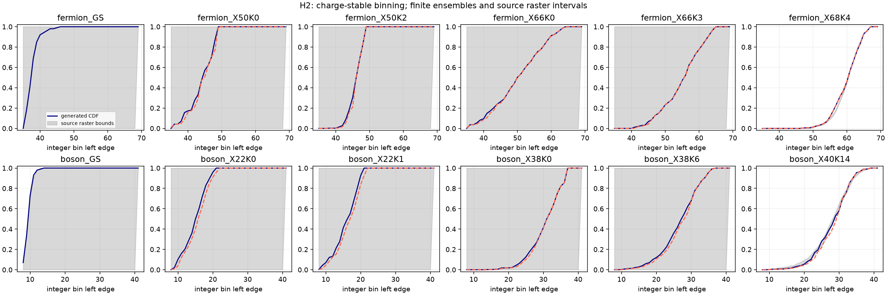
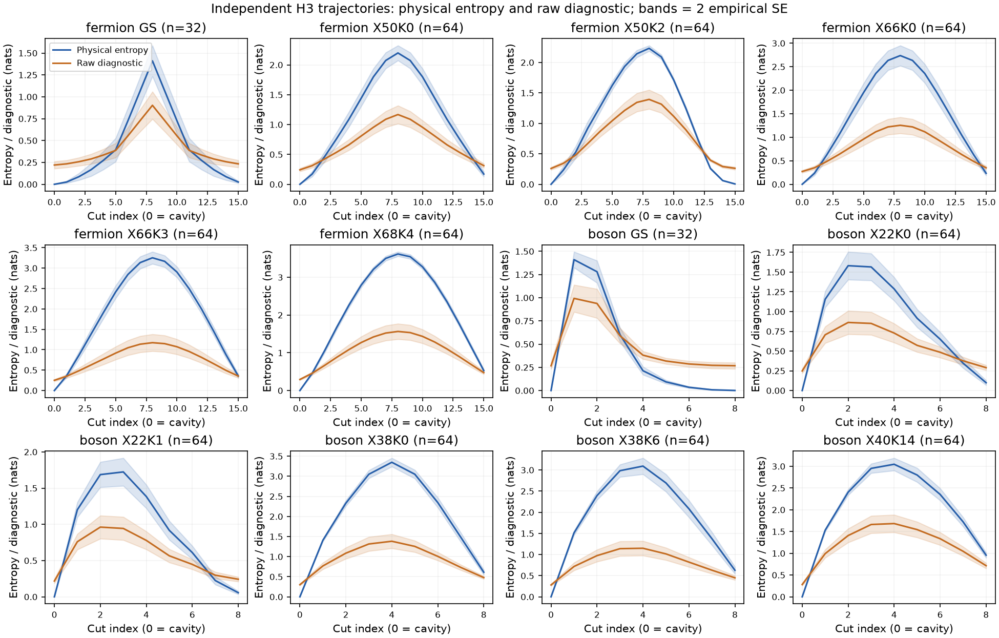
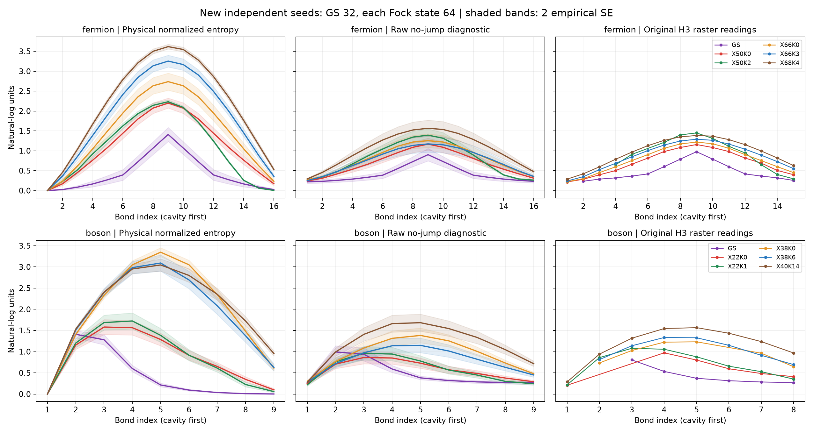

# Liouvillian skin effect：暗态结构与 H3 熵差异

**结果：暗态结构和多项有限系统计算得到支持；H3 的主要图形差距可由一个固定的未归一化诊断量大幅缩小，但这不确认作者实现，也不完成大样本和截断验证。** 本报告截至 2026-10-13，对应 Halati、Jin、Moessner 的 [Constructing Large and Structured Decoherence-Free Subspaces in Hybrid Quantum Systems，arXiv:2610.12348v1](https://arxiv.org/abs/2610.12348v1)。

[English](reproduction-note.en.md) · [运行代码](../code/README.md) · [证据索引](../docs/EVIDENCE_INDEX.md) · [如何量化复现程度](../docs/QUANTIFICATION.md)

## 1. 论文的核心物理问题

一个有耗散的体系，为什么最终能够保留丰富的多体态，而不是只落到一个简单态？这篇论文把物质与有光子损耗的腔耦合。腔耗散持续选择物质算符的零空间；非互易运动使态向边界积累，而对称性进一步约束允许的演化和长时间状态。

这里的 Liouvillian skin effect 指开放系统动力学中的非互易积累。它和“稳态空间很大”有关联，但两者不是同一个命题。要检查论文，需要分别验证暗态空间、相关与纠缠，以及从指定初态出发的耗散动力学。

本文比较的图是理论和数值结果。本次没有因缺真实实验设备而豁免任何尚未完成的数值计算。

## 2. 模型与计算方法

开边界定粒子数链采用

$$
O=\sum_{j=1}^{L-1}c_j^\dagger c_{j+1},\qquad
H/\hbar=\delta a^\dagger a-g(a^\dagger O+aO^\dagger),
$$

$$
\dot\rho=-\frac{i}{\hbar}[H,\rho]
+\Gamma\left(a\rho a^\dagger-\tfrac12\{a^\dagger a,\rho\}\right).
$$

若 $`O|\psi\rangle=0`$，则腔真空与该物质态的乘积被 Hamiltonian 和跳跃算符共同湮灭。因此零空间中的态及相干组合构成一个 decoherence-free subspace。这证明了所构造子空间的稳态性质，不自动证明更一般模型的所有稳态都必须具有这种形式。

静态部分用固定位置和配对量子数的 Fock 扇区、稀疏算符和零空间求解；动力学部分用 photon-counting quantum trajectories。声明条件包括初始腔真空、有限光子截断、明确的 ODE 容差和随机流。相干 GS 的非线性熵必须保留不同总荷扇区之间的相干，不能由去相干后的线性均值替代。

[详细推导](../docs/DERIVATION.md)解释强对称性、Hamiltonian 守恒荷和轨迹跳跃之间的区别；[数值方法](../docs/NUMERICAL_METHODS.md)给出配置与运行命令。

## 3. 暗态与统计比较得到什么

原尺寸为 $`N=8`$，fermion $`L=16`$、boson $`L=9`$。两者的全部暗态维数公式均给出 526。选取的 23 个 $`(X,N_p)`$ 扇区完成了零空间、配对量子数、密度、相关和熵计算；最大零空间残差约 $`2.61\times10^{-14}`$，配对残差约 $`9.88\times10^{-14}`$。



这是独立生成图；原图对应及必要参考摘录见[比较说明](../docs/COMPARISONS.md)。有限系统的纠缠剖面不单独证明渐近体积律。

Haar 统计补充对 23 个扇区各抽取 512 个完整正交基，共 11776 次基抽样。线性观测量均值的迹不变性误差最大约 $`4.88\times10^{-15}`$。源图比较中，344 个已定位均值点有 300 个可可靠解析，44 个保持未知；这是参考图读取覆盖，不是复现成功率。

标准差的 `ddof` 约定会影响比较。在维数一致、可读的子集上，采用 `ddof=1` 的联合有限样本比较得到 $`p\approx0.214`$。未拒绝这个统计模型不等于确认同一数组，也不能延伸到遮挡点。源图扇区维数标签和其余面板仍有未闭合事项。

## 4. H1 与 H2：定义和数值边界很重要

**H1 的纵轴定义存在具体歧义。** 原文图轴写 $`\langle O_+O\rangle`$，图注和相邻文字写 $`\langle O^\dagger O\rangle`$，但 $`O_+\ne O^\dagger`$。未加权 $`O`$ 在固定 $`N=8`$ 空间满足 $`\|O\|\le8`$，故归一化态有 $`\langle O^\dagger O\rangle\le64`$；图中超过 100 的值不能同时符合这些条件。



在 12 个初态各 500 条、共 6000 条轨迹中，Hermitian 候选 $`2\mathrm{Re}\langle O_+O\rangle`$ 与 94/94 个固定读点相容，未加权量为 0/94。因子 2 和算符来自先前的初态检查，没有调节 Hamiltonian 来贴图。该候选不正半定，趋于零不能替代 $`\|O\psi\|^2\to0`$ 的暗态判据。结果定位了定义问题，尚未确认作者实际测量程序。

**H2 的整数分箱曾有我们自己的数值问题，已明确修正。** 对固定总荷 $`Q`$ 的 Fock 轨迹，$`X=Q-\langle n_{\rm ph}\rangle`$。即使正光子尾部极小，真实 $`X`$ 也可能仍位于整数左侧。采用

$$\lfloor Q-p\rfloor=Q-\lceil p\rceil\quad (Q\in\mathbb Z,\ p\ge0)$$

可以避免浮点减法把正尾部吞掉。5000 条既有轨迹的分箱与 400 位 Decimal 检查一致，其中 1616 条不同于旧 float-floor 结果。新的 40 条末段尾部对照没有改变分箱；它检查有限传播敏感性，不是无限精度物理 bin 的证书。



此为原文 Fig. H2 的必要比较，参考内容不属于仓库开放内容许可。灰带来自读图计数区间，不是作者误差条；红色虚线表示修正前的浮点 `floor` 分箱，蓝线为修正结果。两条完整可读曲线与保守两样本界相容，其余曲线因遮挡和有限样本检验能力较弱。

## 5. H3：归一化解释到底验证到了哪一步

每条无跳跃区间的未归一化末态具有范数平方 $`w`$。若单位迹约化矩阵为 $`\rho`$，直接对 $`w\rho`$ 的谱计算得到

$$
S_{\rm raw}=-\mathrm{Tr}(w\rho\ln(w\rho))
=wS(\rho)-w\ln w.
$$

本次从求解器实际末段读取 $`w`$，逐轨道计算后平均，没有从原图拟合 $`w`$、比例、偏移或种子。**$`S_{\rm raw}`$ 依赖向量缩放，不是单位迹 von Neumann 熵。** 仅换 bits/nats 也不能解释从零开始的正基线。



上述两种量都由相同的[逐轨迹数组](../outputs/data/h3/samples.npz)计算。下面加入原文 Fig. H3 的固定读点，参考内容仅作核验、排除在仓库开放内容许可之外。



| 量化结果 | 数值与适用范围 |
|---|---|
| 原文参数的新样本 | 704 条；10 个 Fock 初态各 64 条、两种 GS 各 32 条 |
| 额外参数检查 | 36 组共 576 次路径求解；跨组复用随机流，不能全算独立流 |
| 126 个固定读点的物理熵 RMSE | 0.96745 nats |
| 同一读点的 raw RMSE | 0.07732 nats；残差下降约 92.0% |
| 逐初态改善 | 12/12 个初态的逐条 95% bootstrap 改善区间下界大于零 |
| 不同算法的小系统对照 | 72 条；物理熵最大差约 $`3.05\times10^{-12}`$，raw 最大差约 $`5.26\times10^{-12}`$ |

这个证据支持固定 raw 解释具有跨初态稳定性。92.0% 是残差改善，**不是论文复现度**。逐条区间不代表 12 条曲线同时具有 95% 覆盖率；它们不包含未知作者抽样误差及全部读图、截断误差。

先前每种统计 64 条配对的 cutoff $`8\to10`$ 对照中，最大平均物理熵变化为 fermion $`6.59\times10^{-6}`$、boson $`0.001745`$ nats。少数轨迹仍出现跳跃分支切换，不能据此声称严格截断收敛。

原尺寸扩大计算计划为 12 个初态，每个初态在 cutoff 8 求解 512 条轨迹，并在 cutoff 10、12 各求解 128 条配对轨迹，共 $`12\times(512+128+128)=9216`$ 次求解。最新检查显示 worker 已停止，没有完成收据，退出原因未明。**该任务不计作完成样本或收敛证据，也不被归因于作者信息缺失或算力不足。**

## 6. 当前结论与剩余工作

本案独立重建了非互易算符、暗态空间和有限动力学，并纠正了自己的 H2 分箱问题。H1 定义歧义与 H3 归一化候选都有具体量化证据，但尚不足以确认作者实现或宣布整篇完全复现。

仍需完成 H3 大样本与截断检查、其余原图比较、近暗态尾部误差分析，以及部分一般性命题的适用条件。腔初态、具体 unraveling、测量归一化时点、`ddof` 与遮挡曲线数组可由作者信息直接澄清；这些信息需求与我们仍能做的计算分列在[差异与待办](../docs/BOUNDARIES.md)。没有向作者发送邮件。

## 7. 怎样复算

安装本案例 `code/requirements.txt` 后，从仓库根目录运行：

```bash
python cases/2610.12348/code/scripts/run_reproduction.py --mode quick
python cases/2610.12348/code/scripts/run_reproduction.py --mode statics
python cases/2610.12348/code/scripts/run_reproduction.py --mode h3
```

`quick` 实际计算小系统零空间及量子轨迹；`statics` 重跑原尺寸 23 个扇区；`h3` 重跑已完成的 1280 次路径诊断，历史墙时约 24 分钟。它不重启未完成的 9216 次求解。新计算写入新的临时目录，冻结结果保持不变。`--mode verify` 重算已发布数组的不变量，`--mode render` 从这些数组重新作图。完整条件见[数值方法](../docs/NUMERICAL_METHODS.md)。
