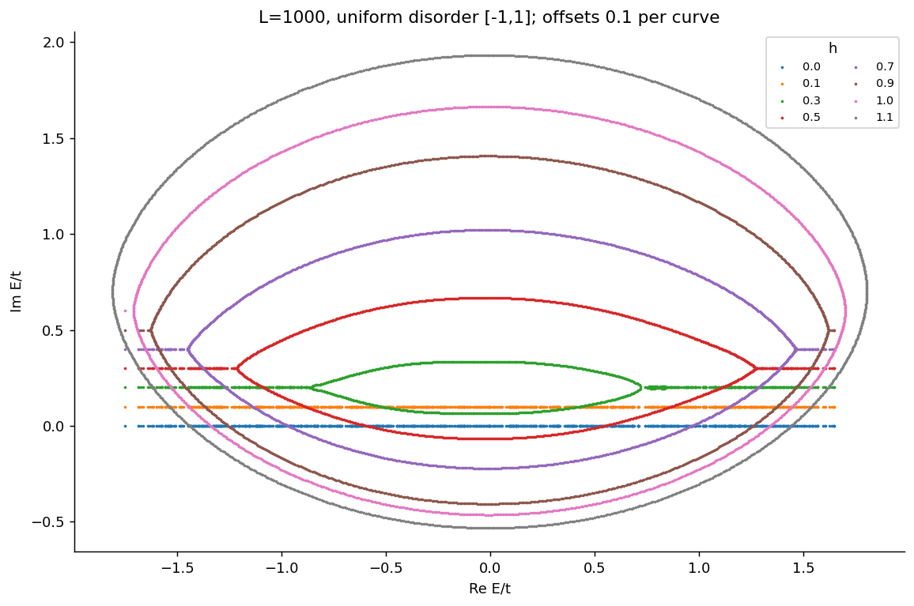
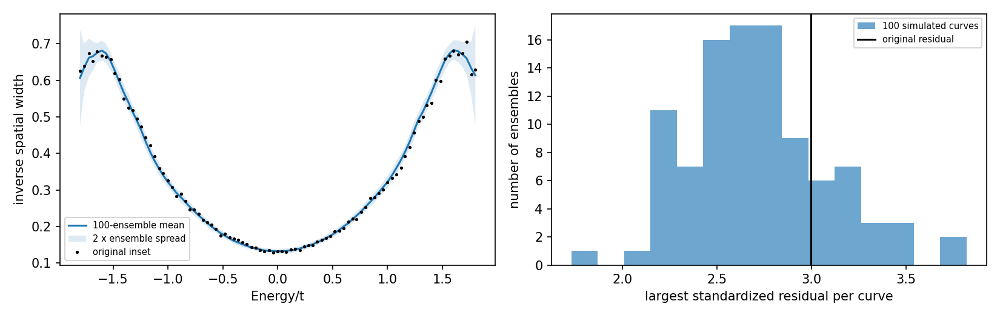

# cond-mat-9603165: Localization Transitions in Non-Hermitian Quantum Mechanics

Preprint: [arXiv:cond-mat/9603165v1 — Localization Transitions in Non-Hermitian Quantum Mechanics](https://arxiv.org/abs/cond-mat/9603165v1)

Published as: [Localization Transitions in Non-Hermitian Quantum Mechanics](https://doi.org/10.1103/PhysRevLett.77.570)

Formal citation: Phys. Rev. Lett. 77, 570 (1996) · DOI `10.1103/PhysRevLett.77.570` · Locator `570`

Public status: **Partial scientific reproduction** · Audit score: **Not assessed / 未评分**

复能谱、局域到离域转变和电流结构得到支持。



## Start Here / 从这里开始

- [中文复现 Note](note/reproduction-note.zh-CN.md)
- [English reproduction note](note/reproduction-note.en.md)
- [简短图文报告 / Illustrated report](docs/report/index.html)
- [推导 / Derivation](docs/DERIVATION.md)
- [复算与范围 / Rerun and scope](docs/NUMERICAL_METHODS.md)
- [Code and run commands](code/README.md)
- [Machine-readable scorecard](outputs/checks/similarity_scorecard.json)
- [Machine-readable completion boundary](outputs/checks/completion_assessment.json)
- [Derivation (equations)](docs/DERIVATION.md)
- [Numerical methods](docs/NUMERICAL_METHODS.md)
- [Lessons learned](docs/LESSONS_LEARNED.md)

## Main Reproduced Results

| Paper item | Reproduced result | Figure | Check |
| --- | --- | --- | --- |
| Declared source targets | 复能谱、局域到离域转变和电流结构得到支持。 | [PNG](outputs/figures/fig2a-independent.png) | [JSON](outputs/checks/numerical-checks.json) |

## Paper Reference vs Independent Reproduction

Comparison reference: Phys. Rev. Lett. 77, 570 (1996), Localization Transitions in Non-Hermitian Quantum Mechanics, DOI 10.1103/PhysRevLett.77.570; fixed source cond-mat/9603165v1. Colored curves/maps are independent calculations; any source marks are limited validation excerpts, excluded from the repository content license. Graphic agreement does not establish author-array equality. Original figures and digitized source point sets are not redistributed.

### hatano-whole-curve-fluctuation.png comparison



### Declared source targets: 复能谱、局域到离域转变和电流结构得到支持。


## Quick Run

```bash
python -m venv .venv
source .venv/bin/activate
pip install -r cases/cond-mat-9603165/code/requirements.txt
cd cases/cond-mat-9603165/code
python scripts/run_reproduction.py
```

Published machine-readable artifacts are kept under [data](outputs/data/), [figures](outputs/figures/), [checks](outputs/checks/).

## Reproduction Boundary

This public case includes paper-derived code, generated data, generated figures, public validation checks, explanatory notes, and 1 limited comparison panels. Those panels use the minimum paper excerpts needed for validation and clearly separate the paper reference from the independent result. The case does not redistribute the paper PDF, arXiv source archive, standalone original figures, EPS paths, digitized source curves, or source-derived point sets.

Remaining limitation: 空间宽度原坐标定义下，原尺度100组无序集合支持余差统计相容；新诊断尚未更新原始对象验收，需保持完整来源对照的明确口径。作者精确种子或代码身份不作为额外完成要求。

Final-parameter rule: final public figures use the paper parameters when feasible. Any reduced-scale, subset, proxy, or blocked target must be labeled explicitly and cannot be presented as a complete reproduction.
