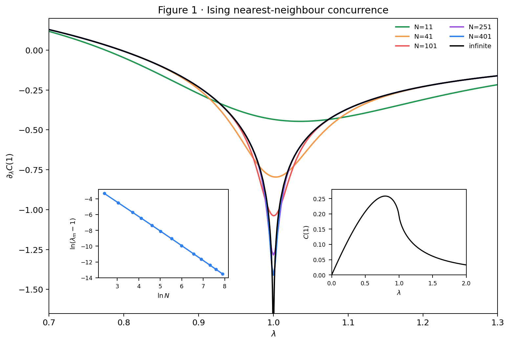

# quant-ph-0202029: Scaling of Entanglement close to a Quantum Phase Transition

Preprint: [quant-ph/0202029v2 — Scaling of Entanglement close to a Quantum Phase Transition](https://arxiv.org/abs/quant-ph/0202029)

Formal publication: **Not recorded as of 2026-10-24**

Public status: **Scientific reproduction — main physical results reproduced** · Audit score: **Not assessed / 未评分**

正文四图、ν=1 标度和纠缠范围结论得到独立计算支持；四处原文表述或图注问题被量化记录。



## Start Here / 从这里开始

- [中文复现 Note](note/reproduction-note.zh-CN.md)
- [English reproduction note](note/reproduction-note.en.md)
- [Final same-agent report](docs/FINAL-REPORT.md)
- [Numerical methods and rerun scope](docs/NUMERICAL_METHODS.md)
- [Recorded boundaries](docs/LESSONS_LEARNED.md)
- [Code and run commands](code/README.md)
- [Machine-readable scorecard](outputs/checks/similarity_scorecard.json)
- [Machine-readable completion boundary](outputs/checks/completion_assessment.json)
- [Derivation (equations)](docs/DERIVATION.md)
- [Numerical methods](docs/NUMERICAL_METHODS.md)
- [Lessons learned](docs/LESSONS_LEARNED.md)

## Main Reproduced Results

| Paper item | Reproduced result | Figure | Check |
| --- | --- | --- | --- |
| Declared source targets | 正文四图、ν=1 标度和纠缠范围结论得到独立计算支持；四处原文表述或图注问题被量化记录。 | [PNG](outputs/figures/figure1.png) | [JSON](outputs/checks/numerical-checks.json) |

### Declared source targets: 正文四图、ν=1 标度和纠缠范围结论得到独立计算支持；四处原文表述或图注问题被量化记录。


## Quick Run

```bash
python -m venv .venv
source .venv/bin/activate
pip install -r cases/quant-ph-0202029/code/requirements.txt
cd cases/quant-ph-0202029/code
python scripts/run_reproduction.py
```

Published machine-readable artifacts are kept under [data](outputs/data/), [figures](outputs/figures/), [checks](outputs/checks/).

## Reproduction Boundary

This public case includes paper-derived code, generated data, generated figures, public validation checks, explanatory notes. It does not redistribute the paper PDF, arXiv source archive, original figures, EPS paths, digitized source curves, source-derived point sets, or source-vs-generated composite panels.

Remaining limitation: 差异按源文本候选记录，不改变物理结论；N^-1.87 解释为有限窗口有效指数。

Final-parameter rule: final public figures use the paper parameters when feasible. Any reduced-scale, subset, proxy, or blocked target must be labeled explicitly and cannot be presented as a complete reproduction.
