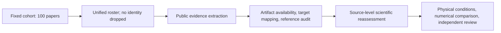

# Unified study flow

The manuscript uses one fixed cohort of 100 paper identities. Availability is attached to measurements, not used to split the paper into origin-based groups.

The current empirical results describe the public evidence audit. Source-level reassessment and scientific acceptance are not completed by this extraction. Each table states its unit and available-data denominator; missing measurements remain unknown. The immutable selection history remains in `../cohort.json` for provenance, and the full roster is in [cohort_100.csv](cohort_100.csv).
