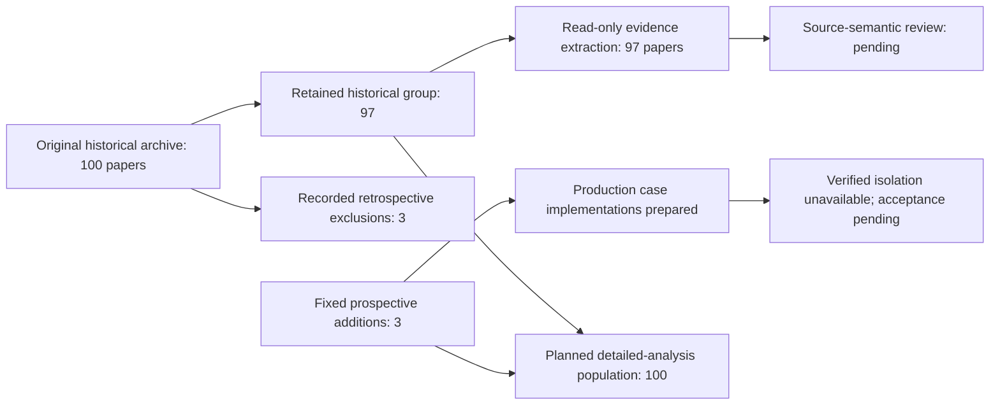

# Study population flow

This diagram reports selection only. It does not depict accepted results or an experimental success rate.

The original 100 records are preserved. The three new identities make the full selection history 103. The detailed analysis will report historical and new groups separately; source availability and selection differ between the groups. Counts originate from `cohort.json` and `data/summary.json`.
